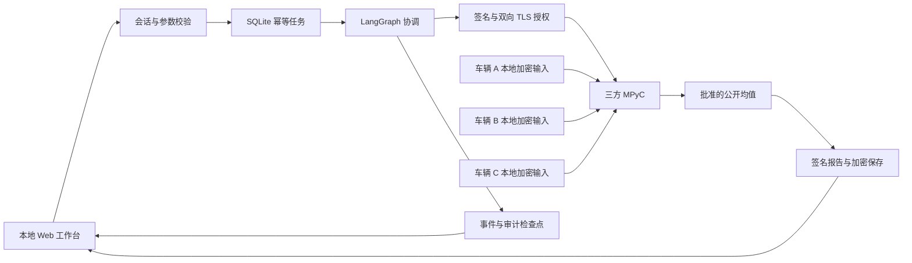
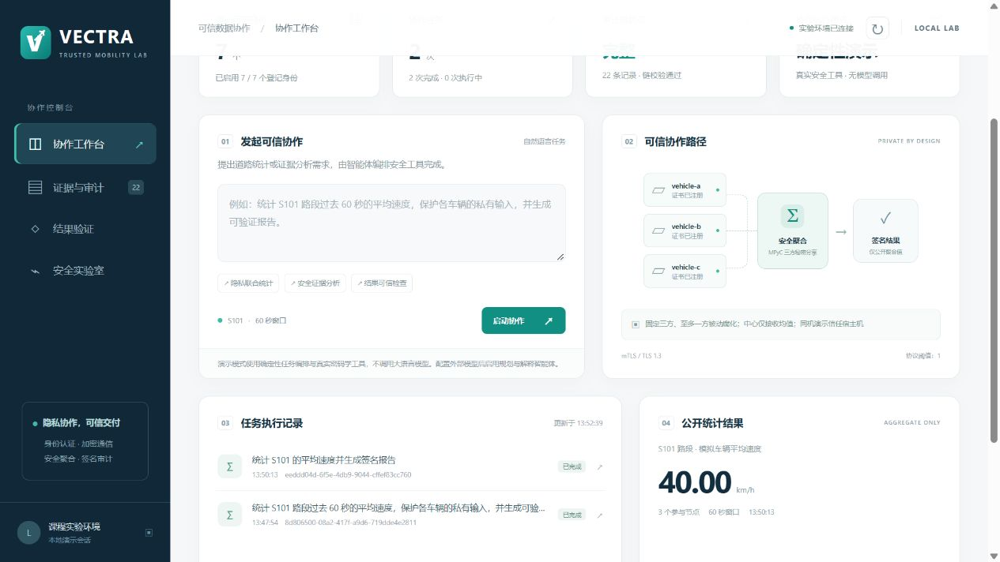

# VECTRA

**面向车联网的多智能体可信数据协作与隐私保护系统**

VECTRA 是一个面向课程实验和本地开发的车联网信息安全系统。它使用多智能体组织任务，通过身份认证、加密通信、真实三方隐私计算和数字签名，完成从协作请求到可验证报告的流程。

`版本 0.2.0` · `Python 3.11–3.14` · `FastAPI` · `LangGraph` · `MPyC`

默认 `demo` 模式安装后即可运行，无需模型 API Key；切换 `llm` 模式可连接支持工具调用的模型服务。

## 目录

- [项目概览](#项目概览)
- [开发环境](#开发环境)
- [项目安装](#项目安装)
- [启动与停止](#启动与停止)
- [使用步骤](#使用步骤)
- [配置说明](#配置说明)
- [开发与测试](#开发与测试)
- [源码迁移与分发](#源码迁移与分发)
- [常见问题](#常见问题)
- [项目详解](#项目详解)
- [贡献指南](#贡献指南)
- [许可证](#许可证)

## 项目概览

- **可信协作**：任务和消息经过身份、数字签名与授权校验。
- **隐私统计**：三个独立车辆进程运行 MPyC，协调端接收批准的均值输出。
- **可验证结果**：签名报告、审计哈希链和检查点用于验证内容与来源。
- **可复现实验**：网页提供消息篡改、重放、身份冒用等七类受控实验。
- **可迁移源码**：统一 Python 入口，根据当前电脑和源码目录创建运行环境。

当前版本用于本机教学演示。详细功能、架构、课程知识对应和安全边界见 [项目详解](#项目详解)。

## 开发环境

### 环境要求

| 项目 | 要求 | 说明 |
| --- | --- | --- |
| Python | **3.11–3.14** | 推荐使用已实测的 Python 3.13；安装时需要 pip 和 venv |
| 操作系统 | Windows、Linux、macOS | Windows 已实测；Linux/macOS 为目标支持平台，已配置 CI，尚未实际执行 |
| 终端 | PowerShell / 命令提示符 / 系统 Shell | Windows 兼容脚本支持 PowerShell 5.1 和 7 |
| 浏览器 | 支持 JavaScript 的现代浏览器 | 默认访问本机 `http://127.0.0.1:8000` |
| 网络 | 首次安装时可下载 Python 依赖 | 安装完成后的 `demo` 模式无需外部模型服务 |
| 文件权限 | 项目目录可读写 | 自动创建虚拟环境、配置和本地运行数据 |
| 本机通信 | 允许 loopback 通信 | Web、TLS 和 MPC 进程使用本机端口 |
| 可选工具 | Git、编辑器、Node.js | Git 用于版本管理；Node.js 用于一项可选的 JavaScript 数值往返测试 |

运行系统无需 Node.js、前端构建工具、Docker、GPU 或独立数据库服务。没有 Node.js 时，对应的可选测试会跳过。

### 已验证环境

Windows 11、Python **3.13.14**、Windows PowerShell **5.1.26100.9444**。已验证源码重新安装、中文和空格目录、运行数据迁移、wheel 分发、真实 MPC，以及真实 Ctrl+C 正常退出。

GitHub Actions 配置 Windows、Ubuntu、macOS × Python 3.11/3.13 六组检查；当前尚未触发该工作流。具体结果与验证范围见 [验证记录](docs/verification.md)。

## 项目安装

### 1. 获取源码

下载并解压项目源码包；项目托管到 GitHub 后，也可使用仓库页面的 **Code → Download ZIP**，或通过实际仓库地址克隆。

在包含 **`run.py` 和 `pyproject.toml`** 的项目根目录打开终端。目录可以包含中文和空格。下面的命令默认在此目录执行，不需要修改脚本中的路径。

已经在当前项目目录开发时，无需重复下载。

### 2. 检查 Python

Windows：

```powershell
python --version
```

Linux / macOS：

```bash
python3 --version
```

确认版本为 3.11–3.14。若 Windows 的 `python` 无法识别，而已安装 Python Launcher，可将 Windows 命令中的 `python` 换成 `py -3.13`。

### 3. 安装并初始化

Windows：

```powershell
python run.py setup
python run.py check
```

Linux / macOS：

```bash
python3 run.py setup
python3 run.py check
```

`setup` 完成以下操作：

1. 使用当前电脑的 Python 创建项目内 `.venv`。
2. 按 `pyproject.toml` 安装当前系统适用的依赖，并以 editable 方式安装源码。
3. 在 `.env` 不存在时，从 `.env.example` 生成配置；保留已有配置。
4. 初始化本地 CA、身份凭证和模拟车辆数据；保留已有有效运行数据。

`check` 显示实际项目目录、虚拟环境状态、数据位置、模式和端口，不输出 API Key。安装无需手动激活 `.venv`，也不会自动启动网页服务。

为开发和测试安装额外依赖，使用 `python run.py setup --test`；Linux/macOS 使用 `python3`。只安装、不初始化数据可加 `--no-init`。

## 启动与停止

### 启动

Windows：

```powershell
python run.py start
```

Linux / macOS：

```bash
python3 run.py start
```

看到服务启动日志后，打开 **http://127.0.0.1:8000**。启动命令在前台运行，保持该终端打开。每次启动无需重新安装依赖。

需要其他端口时：

```powershell
# Windows
python run.py start --port 8001
```

```bash
# Linux / macOS
python3 run.py start --port 8001
```

此时访问 **http://127.0.0.1:8001**。未传 `--port` 时使用配置中的 `VECTRA_PORT`。

### 停止

**方式一：在启动终端按一次 Ctrl+C。** 等待已提交任务完成和终端提示符恢复。正常关闭日志类似：

```text
INFO:     Shutting down
INFO:     Waiting for application shutdown.
INFO:     Application shutdown complete.
INFO:     Finished server process [...]
```

启动器可能显示 `Ctrl+C received; waiting for the service to finish shutting down.`，表示它正在等待子服务退出。按一次后等待即可；再次中断可能触发 Uvicorn 的强制退出。

**方式二：在另一个终端进入同一个项目目录，执行停止命令。**

```powershell
# Windows
python run.py stop
```

```bash
# Linux / macOS
python3 run.py stop
```

`stop` 自动读取本项目正在使用的端口，通过私有控制凭据请求正常关闭。默认等待 60 秒；需延长时使用 `stop --timeout 120`。本项目没有运行服务时，命令直接返回。

### 重启

修改 `.env` 或 Python 代码后，先停止再重新启动。修改 `vehicular/web` 内的网页文件后刷新页面即可。

同一源码目录只允许一个受管理服务或维护操作；项目锁在退出时释放。不同源码副本可使用各自数据目录和不同端口运行。

### Windows PowerShell 兼容脚本

这些脚本委托同一个 `run.py`，按脚本位置定位项目，保持 UTF-8 BOM 编码：

```powershell
powershell -NoProfile -ExecutionPolicy Bypass -File .\scripts\setup.ps1
powershell -NoProfile -ExecutionPolicy Bypass -File .\scripts\start.ps1
powershell -NoProfile -ExecutionPolicy Bypass -File .\scripts\stop.ps1

# 自定义端口
powershell -NoProfile -ExecutionPolicy Bypass -File .\scripts\start.ps1 -Port 8001
```

PowerShell 7 可将开头的 `powershell` 换成 `pwsh`。`setup.ps1` 支持 `-Test`、`-Recreate`、`-NoInit`；三个脚本均可用 `-Python` 指定本机 Python 可执行文件路径。`-ExecutionPolicy Bypass` 仅用于此次子进程。

## 使用步骤

### 1. 执行隐私统计

在「**协作工作台**」输入并提交：

```text
统计 S101 的平均速度并生成签名报告
```

观察任务记录中的身份与授权检查、三方计算、结果分析和报告签名。默认三辆模拟车辆的教学输入为 60、40、20 km/h，公开均值为 **40 km/h**。

普通页面不展示逐车输入。当前批准的统计范围固定为三辆车、S101、60 秒窗口和 `mean_speed`；同一用户的统计查询默认冷却 30 秒。

### 2. 查看证据

工作台新增「**最近安全证据**」卡片。打开「**证据与审计**」，在事件时间线点击「解读此事件」，即可查看失败层、计算阶段和引用证据；也可以点击「分析最近事件」。可从工作台提交安全调查任务；事件拒绝不自动等同于特定节点发起攻击。

离线调查会先校验审计链，再引用实际事件编号，区分任务策略或 RSU 拒绝、MPC 已启动和统计已完成。受控实验会关联其验证事件；没有已验证身份时，调查不会按自称身份归因。调查只覆盖最近的公开事件，缺少阶段记录时会明确保留不确定性。

### 3. 验证报告

打开「**结果验证**」，选择已完成任务的原始报告，点击验证。原报告应验证通过；修改结果字段、保留原签名后再次验证，应发现内容变化。

可下载签名报告并签署审计检查点。验证下载报告需要对应的可信注册表及任务登记。

### 4. 运行安全实验

打开「**安全实验室**」，运行消息篡改、重放、身份冒用、越权查询、报告篡改、密文篡改或参与方离线实验。结果来自实际校验流程，并关联审计事件。

### 5. 命令行演示

```powershell
# Windows
python run.py demo
```

```bash
# Linux / macOS
python3 run.py demo
```

该命令执行真实均值计算、报告验签、七项攻击/故障实验与审计校验，使用独立的 `runtime-demo`。此目录内连续统计同样遵守冷却时间。

## 配置说明

首次安装会创建 `.env`。默认配置可以直接运行 demo 模式；修改后需要重启。

| 配置项 | 默认值 | 作用 |
| --- | --- | --- |
| `VECTRA_MODE` | `demo` | `demo` 为离线模板，`llm` 为外部模型工具调用 |
| `VECTRA_DATA_DIR` | `runtime` | 数据位置；相对路径始终按项目根目录解析，迁移时推荐保持相对路径 |
| `VECTRA_HOST` | `127.0.0.1` | 仅允许 loopback 地址，也支持 `localhost`、`::1` |
| `VECTRA_PORT` | `8000` | 网页端口，范围 1–65535；`start --port` 优先 |
| `VECTRA_QUERY_COOLDOWN` | `30` | 同一用户统计查询冷却秒数，须为非负有限值 |
| `VECTRA_MPC_TIMEOUT` | `20` | MPC 超时秒数，范围 1–120 |
| `LLM_BASE_URL` | `https://api.openai.com/v1` | 兼容 Chat Completions 接口的服务基础地址 |
| `LLM_API_KEY` | 空 | llm 模式需要的模型服务凭据 |
| `LLM_MODEL` | 空 | llm 模式需要的、支持工具调用的模型名称 |

系统环境变量优先于 `.env`。`run.py` 总是使用自身所在目录作为项目根目录；无需把旧电脑的绝对路径写入配置。

### 接入模型服务

在已有 `.env` 中设置：

```dotenv
VECTRA_MODE=llm
LLM_BASE_URL=https://api.openai.com/v1
LLM_API_KEY=replace-with-your-api-key
LLM_MODEL=replace-with-your-tool-capable-model
```

把示例凭据和模型名替换为实际值，停止后重新启动。模型需要支持 Chat Completions function calling；当前代码向基础地址后的 `/chat/completions` 发起请求。

用户文本和批准的公开摘要会发送给模型服务。私钥、单车速度与秘密份额不会交给模型。模型服务不可用或缺少必要工具执行时，任务会失败，不会自动改用模板。当前已验证模拟模型接口，尚未验证真实外部模型服务的质量、延迟和费用。

两种模式和 Agent 权限见 [项目详解](#项目详解)。

## 开发与测试

### 本地开发

```powershell
# Windows：安装测试依赖
python run.py setup --test

# 执行测试
python run.py test

# 查看命令说明
python run.py --help
```

Linux/macOS 将以上命令中的 `python` 换成 `python3`。项目为 editable 安装，Python 源码修改在重启服务后生效；网页没有独立构建步骤。当前启动器不提供自动重载参数。

将额外 pytest 参数放在 `--` 后，例如只执行迁移相关测试：

```powershell
python run.py test -- tests/test_launcher.py tests/test_portable_paths.py tests/test_cli_portability.py --basetemp .pytest-portable --tb=short
```

测试覆盖密码与身份、真实多进程 TLS/MPC、API 和 Agent 边界、幂等、重放、审计及迁移。测试使用临时数据，不覆盖现有 `runtime`。

### 依赖与 CI

- `pyproject.toml` 声明 Python 版本、跨平台依赖范围、测试依赖和 CLI 入口；MPyC 固定为 0.11。
- `requirements.txt` 提供 `-e .` 兼容入口；推荐通过 `run.py setup` 安装到项目环境。
- `docs/dependencies-windows-python313.txt` 为开发时的 Windows/Python 3.13 依赖快照，不作为其他系统的默认安装锁文件。
- [.github/workflows/ci.yml](.github/workflows/ci.yml) 定义跨系统全新安装、测试及源码打包；实际验证情况见 [验证记录](docs/verification.md)。

### 常用命令

下表采用 Windows 的 `python` 写法；Linux/macOS 使用 `python3`。

| 目的 | 命令 |
| --- | --- |
| 安装与初始化 | `python run.py setup` |
| 安装测试依赖 | `python run.py setup --test` |
| 只安装依赖 | `python run.py setup --no-init` |
| 重建本机环境 | `python run.py setup --recreate` |
| 启动 / 指定端口 | `python run.py start` / `python run.py start --port 8001` |
| 停止 / 延长等待 | `python run.py stop` / `python run.py stop --timeout 120` |
| 诊断配置与路径 | `python run.py check` |
| 执行测试 | `python run.py test` |
| 执行独立演示 | `python run.py demo` |
| 升级旧加密报告 | `python run.py migrate-data` |
| 打包源码 | `python run.py package` |

## 源码迁移与分发

### 推荐流程：只迁移源码

在原电脑执行：

```powershell
python run.py package
```

当前版本生成 **`dist/vectra-source-0.2.0.zip`**。打包入口只需要 Python 标准库，可以在安装项目依赖前执行。

源码包包含程序、网页、配置示例、兼容脚本、测试、CI、README 和文档图片；排除 `.venv*`、`.env`、`.vectra`、`runtime*`、私钥、数据库、日志与缓存。

1. 将 ZIP 复制到新电脑并解压到可写目录。
2. 安装 Python 3.11–3.14，在新项目根目录打开终端。
3. Windows 执行 `python run.py setup`、`python run.py start`；Linux/macOS 使用 `python3`。
4. 新电脑生成自己的身份和模拟数据；如需 llm 模式，在本机 `.env` 中重新配置。

**不要把 `.venv` 作为运行环境传送。** 它绑定原解释器和平台依赖。手动复制整个文件夹带入旧虚拟环境时，执行 `setup --recreate`，旧环境会保留到 `.venv.backup-时间戳`，再创建本机环境。

`.vectra` 是本机服务控制信息，不参与迁移。安装与服务运行期间共享项目锁；setup 可在确认没有活动锁后清理异常退出留下的旧状态。

### 保留已有任务、身份和报告

先在**原绝对目录**停止服务，备份完整运行数据，再升级旧加密报告：

```powershell
# Windows；Linux/macOS 使用 python3
python run.py stop
python run.py migrate-data
```

`migrate-data` 会认证报告并将旧绝对路径绑定升级为可迁移格式；重复执行只验证已升级文件。损坏文件会报错并保持原样。旧报告必须在移动前升级；若已经移走，应先恢复到原路径再升级。

随后迁移源码，将**完整 `runtime`** 放入新项目根目录，再执行 `setup` 和 `start`。该目录包含 CA、身份私钥、车辆数据、报告存储密钥、任务数据库、重放记录和审计检查点，只复制报告密文不足以解密及完整验证。

运行数据含私钥，使用你信任的传送方式。`.env` 按新电脑重建，推荐保持 `VECTRA_DATA_DIR=runtime`；如果使用了自定义数据目录，应迁移那个完整目录并更新相对配置。

### Python 安装包

开发者可构建 wheel。Windows：

```powershell
.\.venv\Scripts\python.exe -m pip wheel --no-deps --wheel-dir dist .
```

Linux / macOS：

```bash
./.venv/bin/python -m pip wheel --no-deps --wheel-dir dist .
```

wheel 包含 `vehicular/web` 页面资源；安装包的配置和数据默认位于调用者的当前目录。在安装该 wheel 的 Python 环境中，可执行 `python -m vehicular.cli serve --project-dir .`，明确将当前目录用作配置和运行目录；Linux/macOS 使用 `python3`。普通使用和跨电脑开发优先采用源码 ZIP 加 `run.py` 的流程。

## 常见问题

| 情况 | 处理方法 |
| --- | --- |
| 找不到 `python` 或版本不符 | 检查 Python 安装和 PATH；Windows 已安装 Launcher 时可使用 `py -3.13`；Unix 使用 `python3` |
| Linux 创建环境时缺少 `venv` / `ensurepip` | 为当前 Python 安装对应的系统组件后重新执行 setup |
| pip 安装失败 | 检查依赖下载网络、代理和 Python 版本；先解决安装错误再启动 |
| 提示环境属于另一个目录 / 电脑 | 使用当前电脑的 Python 执行 `run.py setup --recreate` |
| 提示项目正在运行或维护 | 等待维护结束，或先正常停止本项目，再安装或启动 |
| 默认端口被占用 | 关闭本项目旧服务，或使用 `start --port 8001` 并访问相应端口 |
| API 提示没有会话 | 先打开网页根地址，让浏览器建立本地演示会话 |
| 统计查询处于冷却期 | 默认等待 30 秒再提交新的统计请求 |
| Ctrl+C 后出现等待关闭提示 | 正常等待子服务和已提交任务退出；提示本身不是异常 |
| stop 无法连接 | 确认在同一项目执行；仍在运行时可在启动终端按 Ctrl+C；崩溃残留状态会在下一次启动或无活动锁的 setup 中处理 |
| llm 模式缺少配置或工具调用失败 | 检查地址、凭据和模型工具能力；离线体验使用 `VECTRA_MODE=demo` |
| 旧报告移动后认证失败 | 恢复到原绝对路径，使用原完整密钥目录执行 migrate-data，再迁移 |
| 临时沙箱中的 MPC 无法通信 | 在允许本机 loopback/socket 的正常开发终端运行 |

## 项目详解

### 项目定位

项目以车联网数据协作为场景，重点保护信息的机密性、完整性、参与方隐私及结果来源。Agent 负责组织任务和解释证据，确定性的密码与授权层负责执行保护机制。

核心过程为 **数据产生 → 认证授权 → 安全传输 → 隐私计算 → 报告签名 → 审计验证**。当前实现对应本地教学系统，尚未接入真实车辆或生产基础设施。

### 功能与课程知识

| 功能 | 当前实现 | 对应知识 |
| --- | --- | --- |
| 身份认证 | 本地 CA、TLS 证书、身份注册与公钥绑定 | PKI、证书、认证 |
| 任务授权 | 固定参与者、用途、路段、时间窗口和输出范围 | 访问控制、最小权限 |
| 加密通信 | TLS 1.3、双向证书认证和应用消息签名 | 安全信道、数字签名 |
| 本地数据保护 | 车辆输入及报告对象使用 AES-GCM | 对称加密、认证加密 |
| 隐私联合统计 | 三个独立进程运行 MPyC，只发布批准均值 | Shamir 秘密分享、安全多方计算 |
| 多智能体协作 | LangGraph 编排，协调与信息安全分析角色分权 | 工具调用、权限边界 |
| 结果验证 | Ed25519 报告签名及任务绑定校验 | 签名、完整性、来源验证 |
| 重放与重复请求处理 | 持久化滑动窗口、请求幂等、查询冷却 | 重放防护、请求约束 |
| 审计验真 | 哈希链及数据库外的签名检查点 | 哈希、审计、可验证记录 |
| 安全实验 | 七项实际负向校验及参与方离线实验 | 保护机制验证、故障处理 |

### 执行模式与角色

| 模式 | 任务组织 | 密码与隐私计算 | 模型要求 |
| --- | --- | --- | --- |
| `demo` | 确定性模板执行统计、调查和验证 | 真实执行 PKI、TLS、签名、AES-GCM、MPC、审计 | 无 API Key |
| `llm` | 两个不同工具权限的 Agent，由 LangGraph 编排 | 同一确定性执行层校验并执行工具请求 | 支持 Chat Completions function calling |

协调 Agent 可以调用批准的统计、委托调查、身份查询和报告验证工具。信息安全分析 Agent 只读取过滤后的事件与公开身份摘要。工具调用预算为每个 Agent 最多六次；没有任意 Shell、SQL、文件读取或私钥导出工具。

模型解释单独标识来源，签名证明内容与签发者绑定，不保证自然语言解释必然真实。

### 系统架构



三个车辆进程分别读取自身样本并参与协议。参与通道要求 TLS 1.3、双向认证，以及参与编号与证书指纹绑定。失败或超时后回收参与进程，不发布部分输出。

### 技术栈

| 层 | 技术 | 用途 |
| --- | --- | --- |
| 服务与 API | Python、FastAPI、Uvicorn | 本地 Web 服务、会话与请求校验 |
| Agent 编排 | LangGraph、httpx | 工作流和受限模型工具调用 |
| 身份与密码 | cryptography、Python/OpenSSL TLS | CA、证书、Ed25519、AES-GCM、TLS 1.3 |
| 隐私计算 | MPyC 0.11 | 固定三方 Shamir 秘密分享 |
| 持久化 | SQLite、本地文件 | 任务、预算、重放、审计及加密对象 |
| 签名规范化 | RFC 8785 / rfc8785 | Python 与浏览器一致的 JSON 签名输入 |
| 网页 | HTML、CSS、JavaScript | 中文工作台；资源随 Python 安装包分发 |
| 验证 | pytest、GitHub Actions | 业务边界、真实协议及可迁移性检查 |

### 界面预览



截图来自一次本地 demo 验证，显示公开均值 40 km/h。任务数量和事件数量是当次运行记录，新安装不会预填这些结果。

### 源码目录

```text
.
├── run.py                     # 安装、启动、停止、诊断、测试与打包
├── pyproject.toml             # Python 版本、依赖和网页分发规则
├── requirements.txt           # editable 安装兼容入口
├── .env.example               # 可迁移配置示例
├── .github/workflows/ci.yml    # 跨平台 CI
├── vehicular/
│   ├── api.py                 # Web API 与本地会话
│   ├── config.py              # 项目根目录与相对数据路径
│   ├── lifecycle.py           # 服务生命周期与停止控制
│   ├── project_lock.py        # 安装、维护和运行共享的标准库项目锁
│   ├── agents.py              # 不同角色的受限工具循环
│   ├── analysis.py            # 离线调查的事件关联与阶段说明
│   ├── service.py             # 任务编排、签名报告和安全实验
│   ├── security.py            # PKI、签名、AES-GCM 与审计
│   ├── transport.py           # 双向 TLS 接入与重放窗口
│   ├── mpc.py                 # 三个车辆进程及超时清理
│   ├── mpc_party.py           # 车辆本地校验和秘密分享
│   ├── storage.py             # SQLite 任务与查询预算
│   └── web/                   # 工作台静态资源
├── tests/                     # 自动化测试
├── scripts/                   # PowerShell 兼容入口
└── docs/                      # 架构、验证记录、图片与依赖快照
```

### 数据与恢复

| 本机生成目录 | 内容 | 源码迁移包是否包含 |
| --- | --- | --- |
| `.venv` | 当前电脑的 Python 环境 | 否 |
| `.env` | 当前配置及可能的 API Key | 否 |
| `.vectra` | 服务锁及私有停止凭据 | 否 |
| `runtime` | 身份、样本、任务、报告与审计 | 否；保留历史数据时单独完整迁移 |
| `runtime-demo` | 命令行演示独立数据 | 否 |
| `dist` | 生成的源码 ZIP / wheel | 不嵌入自身 |

`runtime/reports/*.enc` 保存 AES-GCM 报告对象，任务数据库另存批准公开的报告缓存，数据库没有加密全部元信息。加密存储的新格式不依赖项目绝对路径；旧报告由 migrate-data 认证升级。

正常停止等待任务结束。异常退出后，未完成任务在下次启动时标为失败，不会自动重做统计。审计检查点可导出并独立保存。

### 安全模型与当前限制

- MPC 为 Shamir 三方、阈值 1，按被动攻击和诚实多数模型解释；不抵抗恶意输入或任意两车串通。
- 同一电脑运行所有进程，宿主机管理员仍可访问本地目录；尚未实现独立主机或生产 ACL 隔离。
- 公开均值可能产生推断，固定集合与查询冷却不是差分隐私保证。
- 本地 CA 和注册表为信任根；没有完整 OCSP/CRL 服务。
- 哈希链和独立文件检查点可发现局部篡改与截断；整个目录和签名私钥均被控制的情况需要外部可信锚。
- 签名不证明传感器真实性；拒绝事件不自动证明声称节点攻击。
- 网页仅允许本机访问，当前没有公网部署、正式多用户认证或生产密钥管理。
- 真实外部模型、真实车辆及 Linux/macOS 运行仍需在对应环境验证。

更完整的协议、权限和验证说明见 [架构与安全边界](docs/architecture.md) 与 [验证记录](docs/verification.md)。

## 贡献指南

提交改动前安装测试依赖，并运行与修改相关的测试。涉及密码、TLS、MPC、报告或生命周期时，验证实际协议和关闭行为；涉及路径或分发时，验证新目录安装与源码打包。

Issue 或 Pull Request 应说明问题、修改后的行为和验证结果。请勿提交 `.env`、运行数据、私钥、虚拟环境或本机日志。当前源码还未绑定公开 GitHub 仓库地址，发布时使用实际仓库的协作入口。

## 许可证

当前项目尚未提供 `LICENSE` 文件。README 使用开源仓库的文档结构；项目发布前需明确采用的许可证。第三方依赖遵循各自的许可证。
