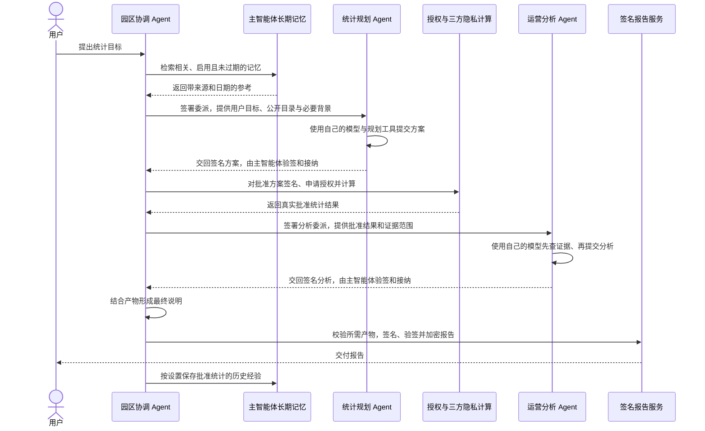

# Agent 工作组与长期记忆

系统采用一个主智能体、两个子智能体的协作架构。它们是三个真实登记的 LLM Agent，可以分别配置不同的模型服务，也可以共用同一模型服务。工具、上下文和交付职责分别受限。

| 名称 | 登记编号 | 负责内容 | 长期记忆 |
|---|---|---|---|
| 园区协调 Agent | coordinator | 理解请求、检索记忆、委派任务、组织隐私计算、复核与最终交付 | 唯一持有者 |
| 统计规划 Agent | planner | 按公开目录确定入口、时间、车次口径和统计指标，提交结构化方案 | 无 |
| 运营分析 Agent | analyst | 查询批准结果与审计证据，提交事实、可能原因、人工建议和不确定性 | 无 |

三家承运商协作节点、安全授权服务和签名报告服务继续负责确定性计算与密码学检查，不调用大模型。系统合计八个登记身份，其中三个为 LLM Agent。

## 查看与配置

打开左侧“Agent 工作组”，可以查看三个 Agent 的模型状态、工具数量、长期记忆分工和执行统计。点击卡片进入详情；对话中的 Agent 昵称也可进入详情。

详情分为“职责与工具”“底层模型”“长期记忆”“执行记录”。工具列表展示登记能力，每轮还会根据统计、调查、报告验证或说明任务进一步收紧实际开放范围。子智能体不能调用主智能体的记忆、历史查询或计算工具。

在“底层模型”填写服务提供商、API 地址、模型、API Key，并选择思考模式。每个子智能体默认显示“待配置”，需要单独填写并保存配置，不能自动使用主智能体或环境变量中的模型与密钥。三个 Agent 可以手工配置为相同的模型服务。已有独立配置会保留；保存后恢复只读，点击“修改配置”再调整。独立的“模型设置”入口已移除，主智能体也从本详情页配置。

保存配置不发送测试请求。系统在接收任务时锁定三个 Agent 的配置快照，排队或执行期间修改配置不会改变该轮任务的模型。模型服务须支持工具调用。

单次模型请求默认等待 120 秒，包括取得响应头和读取完整正文；三个 Agent 都使用服务端 `VECTRA_MODEL_TIMEOUT`，单位为秒，允许 1～600 秒，不根据“深度思考”开关缩短等待。整轮协作另由 `VECTRA_TASK_TIMEOUT` 限制，默认 600 秒，允许 10～900 秒，整轮时限始终优先。调整 `.env` 后重启后端。单次等待超时使用 `model_timeout`，提示具体 Agent、轮次、等待时长、模型和实际地址；整轮超时仍为 `task_timeout`。用户取消继续单独处理，系统不因超时自动重复计算或重放整轮任务。

模型服务明确返回 HTTP 500、502、503、504 或 529 时，只对该轮尚未完成的模型请求最多重试两次，正文保持一致，所有尝试和等待共用原来的响应时限。默认分别等待0.5秒和1秒；服务商提供不超过5秒的 `Retry-After` 时遵循该值，更长的等待直接停止本轮。认证、参数、限流、普通网络异常和已返回200后的解析错误不自动重试；已完成工具不因HTTP重试重新执行。持续服务端错误使用 `model_service_error`，提示具体Agent、模型、尝试次数、服务商错误码及可用请求编号。原始错误正文不展示或写入日志，只提取有长度及字符限制的诊断标识。

“模型接口格式”可选择 Chat Completions 或 OpenAI Responses，三个 Agent 分别保存各自的格式。可填写 API 基础地址或完整接口地址，系统读取与保存时会移除已有的 `/chat/completions`、`/responses` 后缀，再按所选格式拼接一次；已有重复后缀也会规范化，保留本 Agent 的密钥。页面显示实际请求地址。HTTP 请求失败时，提示保留状态码和请求地址，日志的 `endpoint` 字段记录实际目标。原有配置默认保持 Chat Completions。Responses 开启深度思考时发送较高思考强度，未开启时使用服务默认值，部分模型始终推理。

统计请求需要主智能体和两个子智能体都已配置；调查请求需要主智能体和运营分析 Agent 已配置；说明与验签请求只需要主智能体。受理前会一次列出缺少配置的必需 Agent。保存时清理模型名称与密钥中的零宽字符及首尾空白，剩余的内部控制字符会按字段提示；同一服务留空只保留本 Agent 已保存的密钥。

Responses 的工具调用使用 `call_id` 对应执行结果；工具名称、参数、预算和 Agent 权限仍由系统检查。请求使用 `store: false`，本轮续接所需的加密推理项只在内存中回传，不展示在对话详情或诊断日志中。适配依据：[OpenAI Responses 迁移说明](https://developers.openai.com/api/docs/guides/migrate-to-responses)、[函数调用说明](https://developers.openai.com/api/docs/guides/function-calling)。

模型返回 HTTP 200 仅表示收到响应，工具参数仍需通过校验。每个 Agent 的本次执行最多允许一次 JSON 格式更正：整批请求先检查名称与参数，任一参数损坏时均不执行；系统通过原调用编号返回错误，由同一 Agent 重新提交原批次工具。更正仍计入最多六次工具调用的预算，不能改用其他工具、扩大批准范围或跳过内容与证据检查。已完成的统计和已查询的证据保留，不重新运行计算。再次格式错误或未按要求重提时停止交付；对话保留失败、更正与后续执行的真实步骤。

系统不通过删标签、拼接字符串或补造字段来修复 DSML、XML 等混入的参数，也不把格式校验通过当成内容正确。未知工具、越权请求和工具自身的业务校验失败直接拒绝。

## 主智能体如何委派

以下是统计任务的实际处理链。专项任务由子智能体在独立的模型上下文和工具循环中完成；委派目前在本机 Bun 服务内调度，并非远程 Agent 网络。

受理时先确定任务类型、参与身份和交付要求，入口、时间和指标尚未批准，不预填“全部入口”或“60 秒”。早期卡片可以提示原问题中提及的入口，执行范围显示待规划确认；正式统计范围以“批准统计方案”中的入口与起止时间为准。旧早期卡片中的占位字段继续保留在原始记录中，阅读视图不将它们当作实际查询范围。

主智能体可显式调用“委派统计规划”，也可以调用“执行联合统计”，由后端确保先完成必要规划。联合统计完成后，后端按交付要求委派运营分析，避免模型提前结束导致缺失分析。重复调用复用本轮已有产物，避免重复计算或重复委派。

委派消息由主智能体用 Ed25519 签名，绑定委派编号、任务编号、接收身份和输入摘要。子智能体返回的产物回执由自身登记私钥签名，绑定同一委派与产物摘要；主智能体验签并核对绑定。统计方案另外经过入口、时间和指标校验，分析另外经过结构及真实证据引用校验。签名证明来源和绑定，不证明模型推理正确或原始事件真实。

对话保留各自头像、昵称、真实时间和八个阶段标签；委派与产物交接卡片提供协议目的、实际签名和校验依据。

## 只有主智能体持有长期记忆

主智能体详情中的“长期记忆”提供以下功能：

- 添加、修改、搜索、分类、置顶、停用和删除记忆，设置有效期。
- 按用户偏好、业务说明、操作经验、历史任务分类查看。
- 查看记录时间、来源对话、引用次数和有效状态。
- 开关记忆检索，设置每轮最多引用1—8条，默认5条。
- 选择是否把已完成统计任务的批准结果保存为历史经验。

用户可以在页面手工维护，也可以在对话中明确要求：“请记住，以后分析入口运行情况时优先说明排队时长和有效车次数。”主智能体仅在本轮有明确记忆要求时开放写入工具；不会自动把所有回答写成用户偏好。

自动保存的历史经验来自已完成任务的批准查询与真实指标，不是任意模型回答；默认30天有效，最多保留200条未置顶的自动历史经验。全部记忆最多1000条。关键词与中文词片段用于相关性检索，同时考虑置顶和更新时间，不使用向量数据库。停用或过期的内容不进入新任务。

子智能体不能读写记忆库。主智能体按相关性选取背景，作为带来源的任务数据交给子智能体；这不构成子智能体的长期记忆。记忆不能授予权限、覆盖当前明确要求或代替当前统计，历史结果必须保留日期和口径。

记忆正文在 SQLite 中以 AES-256-GCM 加密保存，绑定主智能体和记忆编号；记忆操作日志只记编号和操作结果，引用的记忆正文及模型凭据不作为新增日志字段写入 Git 诊断日志。原始用户消息继续遵循既有诊断脱敏规则。删除对话只清理相应对话与 Agent 执行记录，不删除或改写任何长期记忆：正文、来源编号、启用与置顶状态、有效期、版本和引用计数均保持原样。来源对话已删除时，页面显示说明，记忆仍能按独立设置检索和管理。已有任务仍使用执行时取得的上下文；单独删除或停用记忆影响后续检索。

## 执行记录与升级

每个 Agent 的详情展示累计与最近30次执行，包含父智能体、实际模型、开始/结束时间、执行段状态和产物摘要；整轮交付仍以对话最终状态和签名报告为准。执行记录在本机加密保存，重启后仍可查看；被重启中断的执行标记为未完成，不自动重放有副作用的工作。

已有版本升级时，系统沿用现有证书机构及所有原身份密钥，只新增 planner 和 analyst 的证书与密钥，不清空对话、报告、审计或业务数据。旧报告仍按原签署者和原始内容验签。
