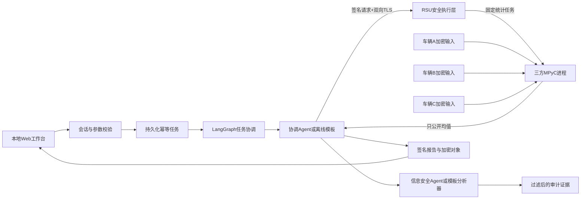

# 实现架构与安全边界

## 运行流程

浏览器在 loopback HTTP 页面建立 HttpOnly、SameSite Strict 演示会话；API 校验本机 Host 和写入 Origin。RSU 是进程内启动的独立 TLS HTTP 接入线程，只有持有效客户端证书的协调服务可请求授权。三辆车通过独立 Python 子进程参与 MPC，拥有不同数据路径与 TLS 身份。CA、RSU、报告与数据执行模块是确定性服务角色。

## 身份、权限与工具

本地 CA 签发 RSA TLS 证书，注册表固定证书指纹与独立 Ed25519 应用公钥。证书私有扩展绑定应用公钥摘要，URI SAN 绑定节点身份。接收端验证 CA 签名、有效期、用途、注册状态和传输/签署者一致性。

统计任务绑定任务 ID、请求 ID、协调者、用途、固定参与集合、路段、窗口、输出指标、接收者与有效期。RSU 检查任务，每辆车再独立校验。外部模型输出不会绕过这些规则。

| 主体 | 允许行为 | 禁止行为 |
|---|---|---|
| 本机演示管理员 | 提交任务、查看公开报告、运行隔离的实验 | 页面中无私有输入/密钥读取接口 |
| 协调 Agent | 固定三方统计、委托调查、验报告、查身份 | 单车输入、任意代码、权限修改 |
| 信息安全 Agent | 事件摘要、公开身份查询、解释证据 | 私有数据、计算启动、吊销或隔离 |
| 车辆进程 | 读取自身加密样本、参与批准的协议 | 更改参与集合或扩大输出 |

LLM 的工具循环最多六次调用；权限错误终止流程。统计请求必须有实际 `result` 才能签发报告，调查请求必须有分析证据。模型解释带独立来源标识；引用检查保证事件 ID 存在，不构成对所有自然语言断言的语义证明。

离线调查在读取事件前验证审计链及签名检查点。任务策略与 RSU 的拒绝事件分别记录失败层；已签名任务可关联任务 ID。三方计算开始调度时记录 `mpc_started`，与 `statistics_completed`、`task_failed` 一起限定调查所能确认的阶段。受控实验记录对应验证事件 ID。缺少阶段记录时仅说明证据不足，不以声称身份归因。

工作台显示最近安全证据，证据页允许按事件编号请求确定性分析。`GET /api/evidence/analysis` 仅返回最近公开审计事件的结论；指定 `event_id` 时只接受该范围内可调查的事件。该接口受本地会话保护，分析前同样验证审计链。

## 隐私计算

每个进程读本地 AES-GCM 加密对象，在自身完成单位、范围和时间校验。模拟源在任务时刻生成新的本地读数；记录源则检查实际 `observed_at`。速度按百分之一 km/h 编码后进行安全求和，聚合结果只向参与方 0 揭示，由它发布批准的均值。中心不读取单车密文/密钥或秘密份额进行计算。

MPyC 固定为 0.11，因为参与端绑定对其 `MessageExchanger` 接口作了兼容实现。启动使用 `m=3,t=1`、SSL 和 loopback 监听；每个 peer 的 TLS 证书指纹固定到相应参与编号，防止持另一个合法节点证书的身份混淆。失败时回收子进程、删除临时任务凭证、不发布部分输出。[MPyC 官方文档](https://mpyc.readthedocs.io/en/latest/)

该协议按被动攻击与诚实多数模型解释：最多一方好奇但遵循协议。真实数值范围由本地代码检查，恶意参与方绕过本地程序或造假传感器并不被这套被动安全协议解决。同机进程不是抵抗宿主机管理员的边界。

## 重放、查询与恢复

签名普通消息按已认证发送者、会话和序号维护 64 项滑动窗口，首次出现的窗口内乱序消息可被接收；重复和窗口外消息拒绝。有效期限制旧会话消息。记录保存在 SQLite，重启后仍生效。

统计 API 原子保存请求 ID 与请求摘要。相同 ID/相同内容复用任务，相同 ID/不同内容拒绝。任务在工作线程顺序执行；未完成任务在服务重启后标为失败。固定输出与集合、30 秒查询冷却用于限制演示查询行为，不能保证差分隐私或阻止所有辅助知识推断。

## 报告、保存与审计

报告使用登记的 `report` 身份签名，验证时忽略对象自带任意公钥，只使用可信注册表。额外校验报告类型、接收者、任务 ID、请求 ID 与用户请求摘要。报告正文写入 AES-GCM 对象文件；批准公开的报告另在任务库缓存。

签名输入和审计摘要使用 [RFC 8785 JSON Canonicalization Scheme](https://www.rfc-editor.org/info/rfc8785/)；浏览器 JSON 解析与再序列化后的合法数值仍能验证，修改语义内容则失败。超出安全数值域或非法编码的数据拒绝进入签名过程。

审计链每条包含前序摘要、事件 ID、时间、类型、允许公开的详情及声称/已验证身份。自动维护数据库外的签名检查点。验真同时检查链内容与最新检查点，能检测删除尾记录和重算哈希后的改动。数据库/检查点/私钥由同一管理员完全控制的场景，需要独立保存的外部锚。

实现使用 [cryptography 的证书与密码原语](https://cryptography.io/en/stable/x509/tutorial/) 和 Python/OpenSSL TLS；没有自行设计新的通信加密协议。
