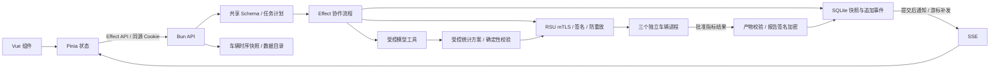

# VECTRA 1.0.3 架构

## 模块与领域模型

Collaboration 组合 Store、Audit、Security、ModelSettings、Gateway 和 MpcRunner。Effect 管理错误、超时、取消和计算信号量。最多两个独立会话任务同时运行，同一会话按顺序执行以保留上下文，统计协议单独串行；配置快照避免任务中途改变服务和凭据。

- conversations：会话标题和更新时间。
- deleted_conversations / deleted_requests：已删除会话与请求 ID 的最小标记，阻止旧请求重试及事件回放恢复已删除内容。
- messages：用户输入与完成后的公开助手说明。
- tasks：当前状态、计划与批准产物。
- steps：稳定 ID、父步骤、角色、方向、说明和当前状态。
- protocol_materials：与步骤绑定的 AES-GCM 加密实验材料；只通过本机会话认证及同源检查的独立接口读取。
- events：只追加的公开事件，保存每次开始、更新、完成和失败。
- reports：以任务上下文为 AAD 加密的签名报告。
- audit：安全事实哈希链，独立于 UI 执行事件。
- replay / budgets：跨重启的防重放记录与查询预算。

步骤快照与对应事件在同一事务提交，提交后通知。报告与最终任务状态一起提交。SQLite 使用 WAL 和索引。完整审计在关键路径验证，概览只展示轻量状态和最近验证覆盖时间。

## 实时与前端

SSE 接受 Last-Event-ID 或 after。先订阅，再同步回放，按事件序号去重。没有数据库定时全量轮询。慢客户端断开后补发；客户端提供断线 HTTP 补发。

Pinia 按任务/步骤 ID 合并增量，Vue 稳定 key 保留卡片 DOM 和展开状态。Markdown 单例解析器按内容变化计算。接近底部自动跟随，阅读历史时提示新进展。

conversation.ts 负责行为主体别名、固定头像配置、动作名称和数据展示映射；原始任务及步骤记录不因显示昵称而改写。TaskInteraction 的每一项交互独立使用 TaskStepCard，左侧 ActorAvatar 与昵称标记实际执行主体，收发方向单独显示。模型响应使用模型服务身份，接收份额事件保留接收车辆为观察主体。正文只从已记录的数据提取速度、份额、回执和结果，不推测缺失值。ReadableData 将详情对象和数组显示为中文字段、列表及表格，ProtocolSection 保留原文切换与完整复制。技术详情默认折叠，展开后才渲染大量报文内容，任务级开关可展开全部步骤。

共享 time.ts 固定 Asia/Shanghai，用于页面日期、日志 ISO 时间、日志文件日期及侧栏日期分组。分组使用上海当地日期序号，跨午夜定时刷新。数据层继续保存 Unix 毫秒时间，不改变签名原文；日志新增记录带实际时区偏移与 timeZone 字段，原有 UTC 行可继续被标准 ISO 解析器读取。

DELETE /api/conversations/:id 复用会话认证和同源检查。Collaboration 对同一会话的删除请求复用同一个 Promise，禁止该会话提交新任务，先移出排队任务并取消执行，再等待进程资源释放。计算信号量的 Effect finalizer 等待本任务 MPC 清理，避免取消后下一个任务误撞 mpc_busy。Store 在一个事务中保存最小删除标记、保留请求 ID、删除关联快照/材料/报告/消息/任务/会话并追加 conversation.deleted；重复删除幂等。审计链与追加事件不改写，公共回放通过删除标记过滤旧内容。SSE 删除事件清理各窗口的缓存、当前选择和 localStorage，选择版本阻止迟到加载响应重新显示已删会话。

页面外壳由固定左侧 AppSidebar 和文档流中的主区域组成，不设置顶部导航栏。会话历史按最近更新时间分组，并通过共享 Pinia 状态在所有页面切换；新对话与历史加载使用选择版本，防止较晚返回的请求覆盖新的选择。消息正文使用浏览器窗口滚动，输入框在页面底部粘性停靠，输入内容自动增高；侧栏列表独立滚动，主区域不建立嵌套的纵向滚动容器。仅当前会话的事件触发对话自动跟随，其他页面由路由管理窗口滚动位置。

## 任务与模型

创建时将明确任务类型或确定性意图识别转为 Plan。关键词只用于选计划，发布依据是计划的结构化产物要求。所有对话统一使用配置的外部模型；未配置名称或 API Key 时提交在创建任务前以 model_not_configured 拒绝，设置及数据管理仍可用。旧设置加载时保留服务及凭据，执行方式统一迁移为模型调用。统计任务执行前由 LLM 通过 submit_statistics_plan 提交 roads、start、end、timeZone、metrics；validateQuery 校验已登记路段、31天时间上限、最多8路段/12指标和严格字段，随后将查询与 datasetVersion 写回任务计划。模型不能修改已批准的范围。

受控统计语言以 speed/distanceKm/energyKwh 为字段，组合 count、vehicle_count、sum、mean、variance、stddev、ratio、ratio_of_sums 和本地阈值 filter。不接受 SQL、JS 或代码字符串。均值与总体方差按有效样本计算；ratio 为条件命中数/有效样本数；ratio_of_sums 用两个完整字段的总量比，支持100倍率表达百公里能耗。缺失字段不补零，零分母返回 null。

Telemetry 发布不可变数据快照，各登记节点可以托管多辆实际车辆；每辆车只能归属一个节点。导入校验所有记录后，先写入以节点输入密钥认证加密的三份快照和版本目录，再原子切换公开 catalog.json。运行任务绑定旧版本，不受并发导入影响。GET/POST /api/telemetry 读取目录或导入完整快照。首次启动创建空目录，统计前需要导入车辆数据；旧的自动生成数据不继续作为当前统计源。原始数据不写入 Git 日志、模型上下文或公开事件。版本快照保留于运行目录，当前没有自动淘汰。

车辆数量由导入记录中不同 vehicleId 决定，不与三个协议节点绑定。participant 可省略；后端先收集并校验明确的车辆归属，再为没有明确归属的车辆使用 SHA-256(vehicleId) 的前32位对节点数取模，以保证跨记录顺序和快照的稳定分配。相同车辆指定冲突归属时拒绝导入。目录记录全局及各路段车辆数、采样数和节点托管计数，不公开车辆编号清单。已有快照首次加载时补充目录统计，版本号与加密记录保持不变。

VehicleDataEditor 支持批量新增车辆、编辑采样、追加记录、删除草稿记录、分页和完整快照发布。GET /api/telemetry/records 仅在用户载入编辑时返回同一版本的目录和原始记录，检查 Cookie、Origin、Sec-Fetch-Site，响应 no-store。编辑保存使用 {records, baseVersion}，服务端版本不匹配返回 dataset_changed，防止覆盖并发导入；原有数组导入继续支持。原始记录仅在编辑组件内存中保留，不写入浏览器持久化、模型上下文或日志。三个节点对各自托管的多车辆数据进行本地筛选和秘密分享；不是每辆车分别获得一套协议身份。

新对话的 QuestionSuggestions 位于输入框上方，按八种统计能力展示范围和提问示例，每6秒轮播，支持手动切换与暂停；悬停、焦点进入和后台页面暂停，组件卸载清理定时器。点击只填入草稿，不自动发送；路段优先取当前数据目录。系统减少动态效果时默认暂停并关闭过渡动画。

协调角色按任务意图获得工具白名单：统计只开放统计、调查、身份工具，验签工具仅用于验签任务。本次报告在产物校验后自动生成，统计不再因提前查找旧报告而失败。分析角色先查询当前范围的实际证据，再用 submit_analysis 提交严格结构与真实事件编号；提交即结束分析，不依赖下一轮自由文本再次包装 JSON。兼容最终回复为纯 JSON 或单个 JSON 代码块，依旧执行相同字段、类型、长度和编号约束；失败记录具体原因。结构检查不证明模型每句推断正确。

compute_statistics 的工具执行包装器在 compute 成功后检查 plan.requires；若要求 analysis，则等待 investigate 查询证据、校验提交并持久化，再向协调模型返回 {...aggregate, analysis}。模型无需另行选择 investigate 才能完成必需阶段。compute 和 investigate 分别复用任务已有产物；同一轮或后续再次调用不重复运行 MPC、预留预算或请求分析角色。分析失败直接传播原错误，计算产物可以保留，但最终报告不会发布；contract_incomplete 仍保留为发布前的最终防线。

已完成的公开消息进入后续上下文，不读取内部推理字段。凭据加密保存并从公开说明中移除。模型失败不自动降级、不重试安全失败或副作用工具。

runAgent 在每次调用的系统消息中提供可信服务端日期、上海 ISO 时间及 Unix 毫秒，避免模型使用训练年份或旧消息推测当前日期。统计规划对明确的中文/数字相对时长调用 resolveRelativeQueryTime，以本次规划开始时冻结的 now 计算区间，再执行 validateQuery；例如过去一小时始终为3600秒。含明确历史日期或复杂多区间表达时不强制替换日期。时间锁定步骤展示服务端锚点和最终起止范围，后续签名及计算绑定同一范围。页面关键时间使用 shanghaiDateTime 展示完整年份、时区偏移；原始 Unix 时间戳不变。

## 三方秘密分享协议

1. 协调器签署批准的路段、真实起止时间、指标语言、数据版本、三个节点、任务摘要与有效期。
2. RSU 与协调器进行真实 TLS 1.3 双向认证，校验证书指纹、消息/任务签名、范围、新鲜性和防重放。
3. 启动三个独立 Bun 进程。子进程不继承模型凭据，不自动加载 .env。
4. 每节点独立验证任务，只解密自己托管的车辆数据，并真正执行路段与 `start≤recordedAt<end` 筛选。本地按每个路段/指标生成四个充分统计量：计数、数值总和、平方和、分母；未使用的分量为零。去重车辆数在节点内计算，导入时禁止车辆跨节点重复归属。
5. 向量每个分量分别使用素数 `2^127-1` 和独立随机一次多项式生成份额，避免复用随机系数。每个节点经 mTLS 交换固定维数份额向量，在各自横坐标逐项相加。
6. vehicle-a 收齐三个聚合向量，逐分量拉格朗日重构，检查数量和数值上限，再计算批准的统计指标，签署查询、数据版本及任务绑定输出。模型和公开结果只接收批准指标；本机实验展示通道另行收集完整输入、私钥、份额和充分统计量供页面查看。
7. 全部进程成功且唯一输出的签名、范围与任务绑定通过后，才记录计算完成。退出、取消或超时都停止发布。

这是新实现的被动安全课堂协议，不能等同于形式化验证。没有迁移 MPyC 的其他未使用协议能力。

一次多项式的数学重构门限为两份，当前执行策略要求三方全部成功。数值以 10000 为比例定点编码，平方和使用编码值的平方；三个聚合份额用系数 3、-3、1 在有限域重构。协调端验证唯一输出、签名、完整查询、数据版本、指标顺序、结果数值和任务绑定。条件比较在各节点本地执行；未实现秘密共享域上的安全比较、排序或乘法协议，因此不支持跨节点最值、中位数和分位数。现有数据是本机导入或演示快照，已执行真实时间筛选，但尚未接入实时道路。

## 完整协议交互展示

Step.protocolDetails 保存公开目的、顺序、校验项和完整公开消息，hasPrivateDetails 仅标记是否有本机实验材料。工作进程将真实原始输入、私钥、随机系数和消息份额写入带任务/步骤 AAD 的临时加密文件，stdout 只传公开进度与文件编号；执行器解密后以另一 AAD 加密存入 protocol_materials，与步骤在同一事务提交，随后清理工作目录。私密数据不会混入公开步骤、SSE、模型工具返回值和 Git 日志。

页面自动通过 GET /api/tasks/:taskId/steps/:stepId/materials 读取完整材料，接口检查已有 Cookie、Origin 和 Sec-Fetch-Site，所有响应 no-store。材料只保存在组件内存，离开步骤时取消未完成请求，不进入 Pinia 持久化、localStorage 或前端操作日志。正文展示可读的原始速度与份额数据，完整 PEM、JSON 和大整数在详情中保留且不截断，使用文档滚动。实验查看者可以恢复单车输入；密码学协议的被动隐私假设不覆盖此展示通道。

TLS 记录来自真实 socket 的协商版本、密码套件、对端指纹和证书信息；没有伪造握手报文或临时流量密钥。历史任务缺少当时的明细时显示缺失提示，不用新随机数冒充旧过程。

## 生命周期与热更新

开发入口管理 Vite 和 Bun watch。前端 HMR，后端硬重启；独占数据目录锁防止两个实例同时修改同一状态。Cookie Key 落盘，热重启后可重连。

正常关闭取消任务、等待本服务的计算进程退出、关闭 SSE/RSU/SQLite 并释放锁。仅确认旧 PID 不存在后清理遗留锁。重启将未完成任务标记失败，不重放副作用。

开发代理保留 Host/Origin，通过 session 接口建立 HttpOnly、SameSite=Strict Cookie。发布同源提供资源并保持严格 CSP；HMR 本机 WebSocket 与样式放行仅限开发模式。

## 诊断日志

Diagnostics 订阅 SQLite 提交后的公开任务事件，输出按北京时间分日的 JSONL 对话日志，并记录 API 请求、任务生命周期、模型 HTTP 状态和内部错误原因。安全审计提交后向操作日志提供独立副本；诊断日志不参与审计哈希链，也不代替签名检查。日志写入异常只提示服务终端，不改变授权、预算或产物判定。

启动时按 CA 派生的 sourceId 和运行目录中的导出游标补写已有公开事件；日志目录变化或游标失效时重新导出。崩溃恢复允许少量重复，以 sourceId/eventId 定位同一公开事件。runId 对应服务实例，HTTP 的 X-Request-Id 与客户端 API 错误对应，任务提交日志连接请求编号和 taskId。

浏览器记录导航、会话切换、发送、取消、连接变化和 Vue/全局运行异常。先使用共享脱敏器处理内容，最多在 localStorage 暂存最近 50 条操作，建立本机会话后批量发送至 /api/client-logs。该接口执行同源/会话认证、严格 Schema 和每分钟 120 条限制，失败重试采用退避，日志发送不经过普通 API 错误记录器以避免递归。

写盘前再次使用共享脱敏器，并加入当前及本进程已知模型密钥、会话和控制凭据的精确替换；递归过滤认证字段、私钥、加密材料、原始输入与份额字段，限制深度和字符串长度。AppError 的内部 cause 仅供日志保留，HTTP 响应仍只返回公开错误代码和说明。默认 logs/ 纳入 Git；凭据、数据库与导出游标仍位于忽略的运行目录。
