# 面向车联网的多智能体可信数据协作与隐私保护系统

项目介绍与功能分析｜VECTRA v1.0.3 当前实现｜2026-10-23（Asia/Shanghai）

> 本文依据 `source code/` 中 `v1.0.3` 分支的当前工作区源码更新，包含尚未提交的工作区功能。原文的“拟实现方案”已改为实际实现说明，后续设想单独列出。示例时序图描述代码允许的成功路径，不代表本次重新调用了外部模型或记录了一次真实道路采样。

## 1. 项目概述

### 1.1 名称与定位

中文名称：**面向车联网的多智能体可信数据协作与隐私保护系统**。

英文名称：**Trustworthy Data Collaboration and Privacy Protection with Multi-Agent Systems for Vehicular Networks**。

系统简称：**VECTRA**。适用场景为《智能网联信息安全》课程展示、本机协议实验和开发研究。

系统通过自然语言对话组织车辆数据协作：协调 Agent 选择批准工具，分析 Agent 根据真实证据解释执行状态，确定性代码负责身份、授权、密码运算、隐私计算和报告发布。当前业务基于本地导入的车辆时间序列，支持多路段、相对或指定时间范围及可组合指标。车辆数量由数据决定，三个固定计算节点执行真实秘密分享协议。

### 1.2 当前项目介绍

用户在 AI 对话页面提出统计、证据调查、报告验签或解释请求。后端先以共享 Schema 和关键词规则确定任务类型，再由配置的模型完成受控查询规划和工具调用。统计任务依次经过查询冻结、签名授权、三个独立计算节点的 Shamir 向量聚合、输出验签、必需证据分析和报告发布，形成可追溯的执行过程。

页面按实际行为主体展示头像、昵称、通信方向、执行状态、中文数据和证据链接。完整报文、签名、证书以及本机实验密钥和车辆原始输入可展开查看。会话、任务和实验材料持久化，公开执行事件经 SSE 增量推送；对话日志和操作日志按上海时间分日并纳入 Git 管理。

当前采用 **Vue 3 + TypeScript + Effect + Vite** 前端与 **Bun + TypeScript** 后端。旧方案中的 Python、FastAPI、LangGraph 和 MPyC 已不属于当前运行技术栈。

### 1.3 阅读本项目时必须明确的四点

1. **60 秒是实际筛选窗口。**服务端锁定起止时间和数据版本，节点真实筛选采样记录；若导入数据不在窗口内则没有有效样本。当前未接入实时道路采集。
2. **三节点协议真实运行于三个 Bun 子进程。**它们执行真实 mTLS、有限域份额计算和重构；节点数不是车辆数，导入记录的真实性仍依赖数据来源。
3. **模型与密码执行分离。**工具白名单、参数验证、权限、验签、预算和发布条件由代码决定，模型文字不能代替实际产物。
4. **完整实验展示扩大了本机观察者的可见范围。**页面可显示原始输入、私钥和份额，因此不能声称这些信息对实验观察者保密；自动发送给外部模型的上下文和 Git 诊断日志仍不包含该私密材料通道。

## 2. 信息安全主线与课程价值

项目围绕“谁可以使用什么数据、如何交换、如何联合计算、如何确认结果来源”组织功能。

| 信息生命周期 | 当前保护机制 | 可以观察的实际产物 |
|---|---|---|
| 本地输入保存 | 每节点快照 AES-256-GCM，版本与身份绑定 AAD | 输入密文、nonce、认证标签、认证解密结果 |
| 任务形成 | 受控查询、冻结版本、请求摘要、JCS 与协调器 Ed25519 签名 | 已签名任务和计划约束 |
| 任务交付 RSU | TLS 1.3 mTLS、登记指纹、外层签名、新鲜性和消息去重 | 实际 TLS 会话属性、签名请求、签名回执 |
| 三节点协作 | Shamir 向量份额、节点间 mTLS、任务绑定与去重 | 六次输入份额发送、回执、本地聚合和重构 |
| 公开输出 | 指定节点签名，协调端核对查询、版本及任务绑定 | 批准指标、有效样本数、节点数与输出签名 |
| 证据解释 | 审计链验证、真实事件编号、结构化分析校验 | 事实、可能原因、建议、不确定性、证据 ID |
| 报告交付 | Ed25519、任务绑定复核、AES-GCM 落盘和回读比较 | 签名报告、存储密文、验签结果 |
| 过程复盘 | SQLite 追加事件、SSE 回放、JSONL 诊断日志 | 可按任务、会话、请求和运行实例关联的记录 |

本项目的教学价值在于把已有密码机制放入一个可运行、可观察的业务链路，说明每项校验发生的位置及其能支持的结论。系统集成与可视化展示本身不等同于密码学安全证明或已经成立的论文创新。

## 3. 当前技术栈与部署结构

### 3.1 技术栈

以下版本来自当前 `package.json`，具体安装解析由 `bun.lock` 固定。

| 层次 | 当前实现 |
|---|---|
| 前端框架 | Vue 3.5.44、单文件组件、Pinia、Vue Router |
| 开发语言 | TypeScript 5.9 系列，前后端及车辆进程统一使用 TypeScript |
| 函数式流程与契约 | Effect 3.22.3、Effect Schema、类型化错误、超时、取消和信号量 |
| 前端构建 | Vite 8.3.5、Vue 插件、开发 HMR |
| Markdown | markdown-it 15.0.3，禁用原始 HTML、校验链接、图片转为链接 |
| 后端运行时 | Bun 1.4.3，Bun HTTP、原生 fetch、子进程和内置 SQLite |
| 数据库 | `bun:sqlite`，WAL、事务、索引、追加事件及审计表 |
| 身份与密码 | `node:crypto`、Web Crypto、`node:tls`、`@peculiar/x509` |
| 规范化与摘要 | `canonicalize` 实现 JCS 规范化，SHA-256 摘要 |
| 隐私计算 | 自实现固定三节点 Shamir 向量聚合，BigInt 有限域运算 |
| 实时传输 | SSE、事件序号、断线回放、Pinia 增量合并 |
| 开发热更新 | Vite HMR + Bun watch，重启后保留持久化状态 |

### 3.2 总体架构

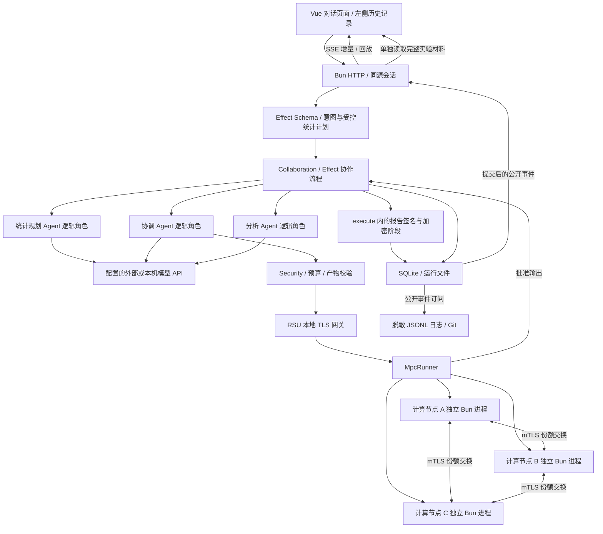

**进程边界：**协调流程、统计规划/协调/分析逻辑角色、RSU 监听、报告步骤、审计与数据库管理位于同一个后端应用中；三个计算节点是独立 Bun 子进程。图中的逻辑模块不能被解释为已经独立部署的微服务或容器。统计规划、任务协调与证据分析角色均通过 `runAgent` 使用配置快照中的模型服务。

**通道边界：**浏览器默认访问本机 HTTP API；节点之间使用 TLS 1.3 mTLS；外部模型地址要求 HTTPS，本机模型服务允许回环 HTTP。不能把这三类连接统称为“浏览器到所有模块均经过 mTLS”。

## 4. 行为主体、昵称与职责

| 页面昵称 | 实际主体 | 职责与边界 |
|---|---|---|
| 任务管家 | 协调 Agent / 协调流程 | 在既定计划下选择允许工具、汇总公开结果；不自行改变统计范围 |
| 安全分析师 | 分析 Agent 逻辑角色 | 查询真实审计证据，提交结构化解释；不读取私密材料接口 |
| 模型助手 | 外部模型服务的公开回复 | 返回公开说明与工具调用建议；内部推理字段不进入展示 |
| 路侧卫士 | `rsu` | 验证认证连接、任务签名、消息上下文与防重放，签发接受回执 |
| 安全守卫 | 安全执行代码 | 固定策略、预算和发布条件检查 |
| 计算助手 | `MpcRunner` | 管理三节点进程、公开端点、取消与唯一批准输出 |
| 小蓝 | `vehicle-a`，计算节点 A | 处理本节点多车辆数据、分享输入、聚合、指定重构与输出签名 |
| 小橙 | `vehicle-b`，计算节点 B | 处理本节点多车辆数据、分享输入，将聚合份额发给小蓝 |
| 小紫 | `vehicle-c`，计算节点 C | 处理本节点多车辆数据、分享输入，将聚合份额发给小蓝 |
| 报告专员 | 报告步骤及 `report` 签名身份 | 报告签名、任务绑定复核、认证加密与交付 |

昵称属于前端展示映射，不改写底层身份标识。当前 PKI 登记六个身份：`coordinator`、`rsu`、`report`、`vehicle-a`、`vehicle-b`、`vehicle-c`。分析 Agent、模型助手和安全守卫等页面角色并非各自拥有独立证书的网络节点。

模型与这些逻辑角色之间的交互是后端函数调用和模型 API 请求，不存在一个已实现的、独立 Agent 对 Agent 的 mTLS 消息总线。

## 5. 功能分析：现有能力与边界

| 编号 | 功能 | 当前实现 | 边界 |
|---|---|---|---|
| F01 | 本地身份与证书 | 本地 ECDSA P-256 CA、节点 X.509 证书、有效期、主机名、指纹、公钥绑定 | 没有身份注册/禁用/轮换管理页面，没有 OCSP/CRL 服务 |
| F02 | 通信与签名 | 真实 TLS 1.3 mTLS；任务、授权信封、RSU 回执、聚合输出及报告使用 Ed25519 | 每条节点份额不额外附带独立 Ed25519 信封，依赖认证 TLS 和消息校验 |
| F03 | 任务授权与工具约束 | Schema、固定计划、按意图工具白名单、无额外参数工具、真实产物门槛 | 不支持任意 SQL、动态协议节点集合或多租户细粒度授权 |
| F04 | 幂等、新鲜性与预算 | requestId 与内容摘要绑定、持久化消息 ID 去重、时间检查、本机全局查询冷却 | 不是 IPsec 位图滑动窗口算法，也没有差分隐私预算会计 |
| F05 | 多车辆多指标隐私统计 | 三节点对导入时间序列进行真实窗口筛选、向量分享与指标重构 | 单次 1—8 路段、1—12 指标、最多 31 天，协议节点固定三个 |
| F06 | 任务协调 | 统一模型规划与有界工具循环；统计工具自动补齐必需分析 | 未取得合法产物就失败，不用模型文字替代计算与分析 |
| F07 | 安全证据分析 | 验证审计链、查询事件、结构化结论、真实 evidenceIds | 结构正确不保证每句模型推断都正确，不直接执行封禁或证书吊销 |
| F08 | 报告与审计 | SHA-256 审计链、签名检查点、报告 Ed25519 签名及 AES-GCM 落盘 | 检查点仍在本机；下载的是解密后的签名 JSON |
| F09 | AI 对话与过程展示 | 独立主体消息、头像昵称、中文字段、份额表格、Markdown、技术详情、证据链接 | 私钥与原始输入可向实验观察者展示，不提供对该观察者的输入保密 |
| F11 | 会话与日志管理 | 上海时区、左侧历史、删除对话、Git 管理的脱敏日志 | 删除不清除 Git 诊断历史、安全审计和数据库追加事件 |
| F12 | 开发热更新与恢复 | Vue HMR、Bun watch、SSE 补发、取消与资源清理 | 后端会短暂重启，不是生产无中断发布；未完成任务不自动重做 |

### 5.1 模型执行与确定性安全边界

当前所有对话统一使用配置的模型服务，已完全删除 Demo 执行模式。模型未配置、响应失败或未提供合法产物时明确失败，不切换本地演示回答。

| 角色或层次 | 当前职责 | 执行边界 |
|---|---|---|
| 统计规划角色 | 通过 submit_statistics_plan 提交查询 | 不执行任意代码；路段、时间、指标由后端校验 |
| 任务协调角色 | 选择批准工具、汇总公开产物 | 工具白名单、空参数约束及调用预算 |
| 证据分析角色 | query_events 后提交 submit_analysis | 验证审计链、字段结构和实际证据编号 |
| 确定性执行代码 | 时间锚点、预算、认证、MPC、签名与发布 | 不以模型文字代替真实产物或安全判定 |

统计规划、协调和分析是不同逻辑角色，可以使用同一配置模型服务；不是三套独立部署的 Agent 系统。每次模型调用都提供可信当前时间，时间显示统一为 Asia/Shanghai。

### 5.2 当前工具范围

| 任务类型 | 协调 Agent 可以调用的工具 |
|---|---|
| statistics | `compute_statistics`、`investigate`、`identity_status` |
| investigation | `investigate`、`identity_status` |
| verification | `verify_latest_report`、`identity_status` |
| explain | `identity_status`，其余依赖批准上下文生成解释 |

分析角色的工具是 `query_events`、`identity_status`、`submit_analysis`。它必须先查询真实证据；`submit_analysis` 校验成功后立即结束该角色的调用循环。兼容返回纯 JSON 或单个 JSON 代码块，但执行相同的结构和证据校验。

统计任务没有“先验证旧报告”的工具入口。本次报告在必需产物完成后由后端自动生成。

## 6. 示例请求与执行前提

用户输入：

> 统计 S101 路段过去 60 秒的平均速度，保护车辆输入并生成签名报告。

### 6.1 数据准备与任务识别

开始对话前，需要在“模型设置”保存支持工具调用的模型服务，并在“车辆数据”导入或编辑带采样时间的记录。新安装不生成示例车辆数据。模型配置不完整时不能提交任务，数据目录为空时统计规划停止。

车辆数量由不同的 `vehicleId` 决定。三个固定协议参与者 `vehicle-a / vehicle-b / vehicle-c` 是**计算节点**，每个节点可以持有多辆车的多条记录。导入时可指定 `participant`，省略时按车辆编号的 SHA-256 稳定分配；同一车辆归属同一节点，避免去重车辆数跨节点重复计算。

本例由 `planTask` 的关键词规则识别为 `statistics`。初始计划给出默认路段和窗口，模型随后提交实际统计方案；默认值不等于最终冻结的查询：

```json
{
  "intent": "statistics",
  "road": "S101",
  "windowSeconds": 60,
  "participants": ["vehicle-a", "vehicle-b", "vehicle-c"],
  "requires": ["aggregate", "analysis"]
}
```

统计任务要求同时取得 `aggregate` 和 `analysis`。正常路径随后由后端生成、签名、验签、加密并保存报告；模型只给出一段总结不能替代真实产物。

### 6.2 “过去 60 秒”如何筛选实际记录

`prepareStatistics` 读取服务端规划时刻 `t0 = Date.now()` 和公开数据目录。模型提交路段、起止时间、时区与指标后，代码校验并将本例的明确相对时间固定为：

```text
roads = ["S101"]
start = t0 - 60000
end = t0
timeZone = "Asia/Shanghai"
metrics = [{ label: "平均速度", operation: "mean", field: "speed" }]
```

`t0` 是本次规划的服务端时间锚点，签名计划同时绑定 `datasetVersion`。每个节点按 `road == S101` 和 `start <= recordedAt < end` 筛选冻结版本中的本节点记录，再计算速度总和与有效样本数。

平均速度是**全部有效速度样本总和除以样本数**，不是各车均值的等权平均。没有有效速度样本时返回 `null` 和无数据说明，不补零，也不挪用其他时段记录。只有导入区间恰有 60、40、20 km/h 三个有效样本时，结果才是 40 km/h；本文不将其当作默认数据或实测记录。查询历史导入数据时，应指定相应历史日期和时间范围。

### 6.3 图的阅读约定

后文将一次成功统计对话拆为八个主流程阶段。第 10 章再画两张辅助图，说明贯穿全程的页面/日志通道和追问/失败分支。

- “规划角色”“协调角色”“分析角色”“报告阶段”是后端逻辑职责，不是各自独立部署的服务。模型角色使用任务提交时锁定的同一份模型服务配置。
- 浏览器使用 Bun HTTP API；模型使用兼容 Chat Completions 的工具调用接口；RSU 和计算节点使用 TLS 1.3 双向认证。不能将所有箭头理解为 mTLS。
- 实线表示请求、调用或交付，虚线表示回复、回执或通知。`par` 表示可并发交错，不承诺真实消息到达顺序。
- 图中的 ID、时间、版本和签名是字段或符号，不是虚构运行值。图不固定模型轮数、执行耗时或页面步骤总数。

## 7. 对话主流程：分阶段时序图与讲解

| 阶段 | 要回答的问题 | 阶段产物 | 进入下一阶段的条件 |
|---|---|---|---|
| 1. 请求受理 | 消息属于哪个会话，是否重复提交？ | queued 任务、用户消息、task_created | 配置、输入、幂等检查通过并取得会话执行位置 |
| 2. 查询规划 | 查什么路段、时间和指标？ | query、datasetVersion、最终 plan | 模型实际提交方案，后端完成校验与时间锁定 |
| 3. 签名授权 | 谁授权计算，RSU 是否接受？ | 内外签名信封、签名接受回执 | 预算、认证、策略、去重及回执绑定通过 |
| 4. 节点准备 | 原始记录如何变成可分享数值？ | 三个 ready、统计向量、随机多项式与份额 | 三个独立节点完成认证输入与监听准备 |
| 5. 份额交换 | 节点怎样联合计算？ | G(1)、G(2)、G(3) 聚合份额向量 | 各节点收齐三个来源并确认交付 |
| 6. 输出重构 | 怎样得到指标，接受哪份输出？ | 唯一签名输出、result、statistics_completed | 进程完成，输出及任务/版本/查询绑定通过 |
| 7. 证据分析 | 证据说明什么，还有哪些不确定性？ | 已保存 analysis、公开模型总结 | 真实查询和结构化提交通过校验 |
| 8. 报告交付 | 怎样生成可下载和复验的报告？ | 报告密文、最终消息、task.completed | 必需产物、审计、验签和加密往返校验通过 |

### 7.1 阶段一：接收消息、建立任务并排队

**目标：**登记用户请求，明确“提交成功”和“执行完成”的区别。

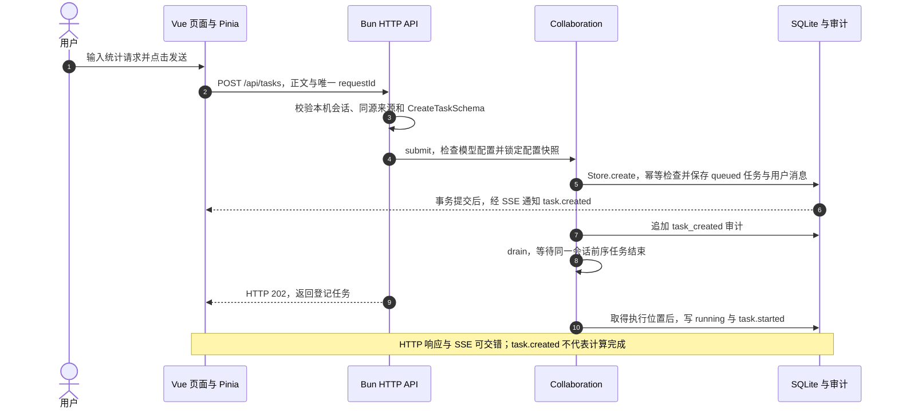

1. 页面发送 `request`、新生成的 `requestId`、意图和可选 `conversationId`。没有会话 ID 就建立新会话；追问关联原会话。
2. 页面初始化已通过 `GET /api/session` 建立本机会话 Cookie，并建立 SSE。写接口检查 Origin 和 Sec-Fetch-Site，再用共享 Schema 验证正文。
3. `submit` 要求模型配置就绪并保存配置快照。用户之后修改模型设置，不改变已提交任务的配置。
4. `Store.create` 在事务中保存会话、任务、用户消息和公开事件。同 ID 同内容返回已有任务，同 ID 不同内容发生冲突；已删除的旧请求不会重新执行。
5. 调度最多执行两个独立会话任务，同一会话串行。统计协议另有全局 MPC 信号量，此时尚未取得。
6. HTTP 202 表示受理，`task.started` 表示开始执行；结果与报告是否完成需看后续阶段。

**完成条件与可核对内容：**taskId、conversationId、requestId 已登记，状态进入 running，存在用户消息与 `task_created` 审计。Cookie 和 API Key 不作为页面协议材料展示。

**失败影响与源码：**会话、配置、输入或队列检查失败时，不进入统计。入口为 `workspace.ts: send`、`index.ts: route`、`service.ts: submit/drain`、`store.ts: create`。

### 7.2 阶段二：LLM 规划查询，服务端冻结时间与版本

**目标：**将自然语言转成受控、可校验、可签名的查询。

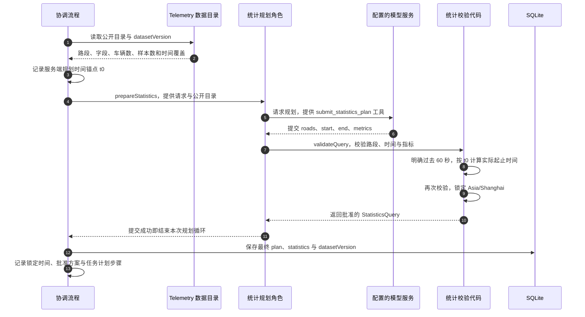

1. 模型看到公开目录中的路段、字段、记录时间覆盖和目录级数量；此处不提供原始记录、私钥或份额。
2. `submit_statistics_plan` 是规划阶段专用工具。代码检查 1—8 个已登记路段、1—12 个指标、最多 31 天的时间区间，以及字段、操作和条件的合法组合。
3. 对本例，`resolveRelativeQueryTime` 根据服务端 `t0` 重新计算“过去 60 秒”，防止模型手算时间戳偏移。明确历史日期的查询保留历史范围，不强改成今天。
4. 受控语言支持计数、去重车辆数、求和、均值、总体方差、标准差、条件比例和总量比值。模型组合已有操作，不执行任意公式、SQL、中位数、分位数或外部道路查询。
5. 最终计划绑定 query 和 `datasetVersion`。后续导入新数据不会改变本次签名任务读取的版本。

**完成条件：**模型实际提交合法方案，最终计划已保存；只回答“我会统计”不满足条件。

**失败影响与源码：**无目录、路段不存在、指标非法或模型未提交方案时停止，不暗中换指标。入口为 `service.ts: prepareStatistics`、`statistics.ts: validateQuery/resolveRelativeQueryTime`、`telemetry.ts: catalog`。

### 7.3 阶段三：调用工具、签署任务并取得 RSU 授权

**目标：**将批准查询转成具有来源、用途、时效和去重约束的授权交互。

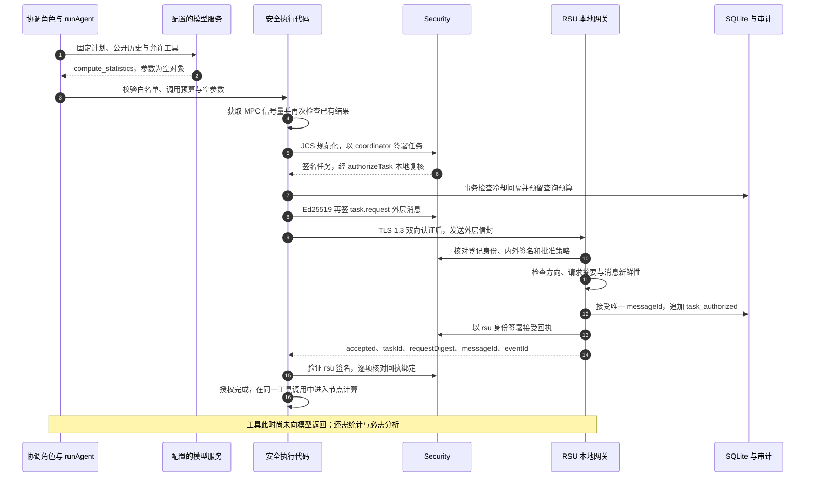

1. 规划后，协调模型进入另一次 `runAgent`。本例可用 `compute_statistics`、`investigate`、`identity_status`，没有提前验证旧报告的工具。
2. 图示常见的 `compute_statistics({})` 路径。若模型先调用 `investigate({})`，统计任务包装器也先完成必要计算，再分析。已有统计会被复用。
3. 内层任务绑定 taskId、requestId、请求 SHA-256 摘要、完整查询、版本、固定节点集合、创建时间、约 90 秒有效期与 `aggregate_vector_v1` 用途。Ed25519 签署 JCS 规范化负载原文。
4. 外层 `task.request` 再绑定 sender、recipient、唯一 messageId、发送时间、请求摘要与内层签名任务。两层签名分别保护批准内容和本次消息上下文。
5. RSU 在真实 mTLS 连接上识别 coordinator，并检查签名、方向、用途、有效期和摘要。外层消息新鲜性为 60 秒，与统计时间区间的 60 秒不同。
6. 持久化去重后，RSU 签署回执；协调端核对 rsu、accepted、taskId、requestDigest 和 messageId。仅有 accepted 字段不足以启动协议。

**完成条件与可核对内容：**预算预留、TLS 认证、策略与回执绑定通过，形成任务签名、实际 TLS 属性、外层签名、RSU 回执与 `task_authorized` 证据。预算预留已经发生，后续失败不代表没有副作用。

**失败影响与源码：**冷却、认证、策略、签名、去重或回执失败时不启动三节点计算。入口为 `service.ts: compute/signedTask`、`security.ts: authorizeTask`、`transport.ts: gateway/exchange`、`store.ts: reserveBudget/acceptMessage`。

### 7.4 阶段四：启动节点、认证解密与生成统计向量

**目标：**各节点使用同一批准任务，在本地将原始记录转成可相加的充分统计量。

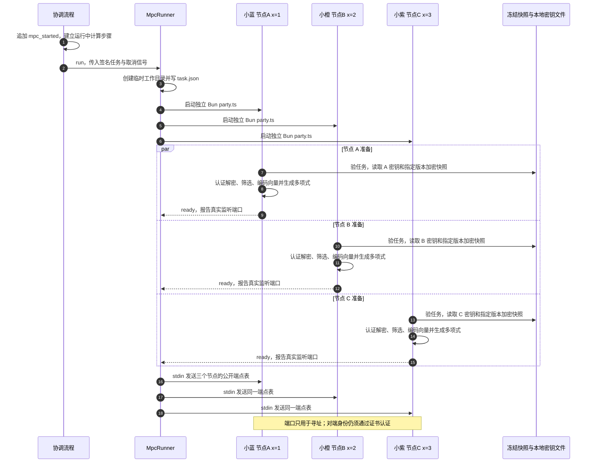

1. `MpcRunner` 启动三个真实 Bun 子进程，参数为 PKI 根目录、节点身份和签名任务文件位置。受控环境变量不继承模型 API Key。
2. 每个进程重新验证签名和授权，再用自己的输入 AES 密钥解密绑定 `telemetry:<datasetVersion>:<participant>` 的快照。一个节点可以负责多辆车，不是固定一车一读数。
3. `localVector` 为每个“路段 × 指标”生成四分量：有效计数、总和、平方和、分母。不需要的分量为零，总维数为 `路段数 × 指标数 × 4`。
4. 每个分量独立生成随机一次多项式和三个份额，节点保留自身横坐标上的份额。数值先按 10000 倍定点编码，平方和使用编码值的平方。
5. 三个节点完成 TLS 监听后各报告 ready；执行器确认端点全部合法到齐才分发端点表。某节点没有区间内数据时仍参与，以零统计向量贡献，不虚构零速样本。

**完成条件与可核对内容：**三个 ready 到齐，页面可核对实际 PID、端口、版本、筛选区间和向量维数；完整输入、密钥、多项式与份额经独立材料通道保存。节点 stdout 不承载这些私密数值，只报告公开进度、traceId、材料标记和后续批准输出。

**失败影响与源码：**输入认证、任务验证或进程准备失败时停止并清理。`mpc_started` 仅证明已调度。入口为 `mpc/runner.ts: run`、`mpc/party.ts`、`telemetry.ts: readTelemetry`、`statistics.ts: localVector`。

### 7.5 阶段五：六次输入份额交换与本地聚合

**目标：**每个节点取得三个来源在同一横坐标上的份额，并在有限域内求和。

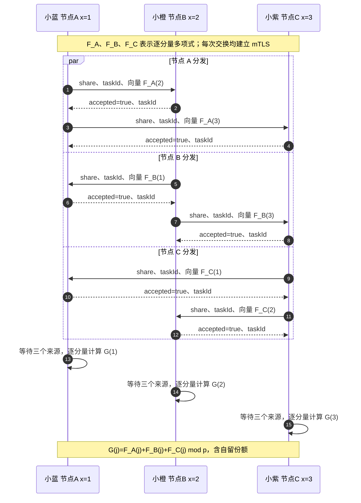

1. 三个节点各向另两个节点发送 `type="share"` 消息，共六次输入份额交付。图中同一分支为了排版列成两条，代码实际通过 `Promise.all` 向对端并发发送。
2. `shares` 是长度等于批准维数的份额向量，不是原始车辆记录，也不是只有一个速度的标量。
3. 接收端核对 TLS 登记身份、对端属于批准集合且不是自己、taskId 相同、方向合法、向量维数一致、每项属于有限域，以及该来源未重复提交。
4. 接收端保存份额后返回 accepted 与 taskId；发送端必须复核回执。连接建立成功不等于业务消息被接受。
5. 每个节点等待“自身保留一份 + 两个对端来源”，再逐分量相加得到 G(j)。此时仍是总量多项式上的一个点，尚未向协调端输出业务结果。

**协议边界：**份额与回执使用 mTLS 内的换行 JSON，没有额外逐条 Ed25519 信封。教学材料通道可以展示完整数值，对外模型工具结果不接收这些份额。

**失败影响与源码：**绑定、身份、维数、有限域、重复消息或回执检查失败时阻断；收不齐会超时，不用两份输入代替三份。入口为 `mpc/party.ts: TLS 接收与 share 分发`、`transport.ts: exchange/checkPeer`、`mpc/field.ts: parseField/mod`。

### 7.6 阶段六：重构、签署输出并保存真实统计

**目标：**由指定节点计算批准指标，后端仅接受与原任务一致的唯一输出。

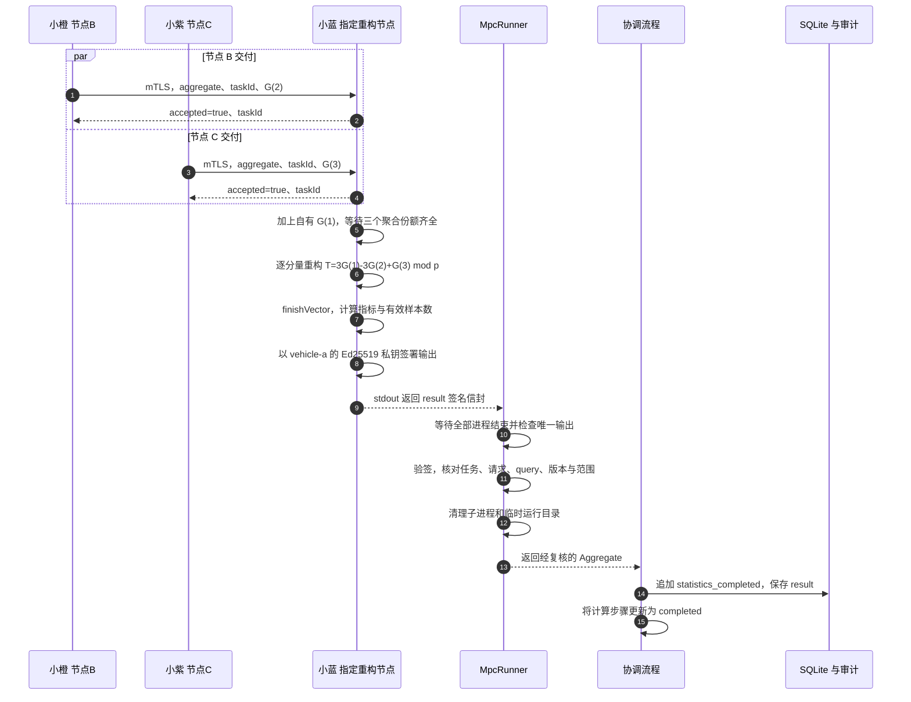

1. B、C 各向 A 发送一次 `type="aggregate"` 交换；A 的 G(1) 本地保留，不走网络。连同上一阶段，共六次输入份额和两次聚合份额发送，各有回执。
2. A 按分量以系数 `[3,-3,1]` 重构总量。一次多项式数学上两点可重构，但当前执行策略要求三个节点齐全，不进行缺席降级。
3. `finishVector` 将计数、总和、平方和与分母转换为批准指标并核对数值上界。无完整样本或分母为零时，按指标规则返回无数据。
4. A 的签名输出绑定 taskId、requestDigest、路段、窗口、版本、完整 query、分路段结果与节点数。只有 vehicle-a 可以通过 stdout 返回 result。
5. 执行器等待三个进程完成，拒绝异常退出、缺少或重复输出；再核对登记签名、任务/查询/版本、结果组数、指标数、标签、数值和样本范围。它没有重新读取全部原始记录独立重算，不能将范围复核解释为可验证计算证明。
6. 执行器返回前清理本次临时目录，页面需要的材料已由 Trace 保存。协调流程随后记录 `statistics_completed` 并保存 result。

**完成条件：**完整运行、唯一输出、验签与绑定均通过。此时统计完成，尚未取得必需分析或正式报告。

**失败影响与源码：**MPC 超时、进程异常或输出检查失败时，不保存替代结果、不发布成功报告。入口为 `mpc/party.ts: 重构与输出`、`mpc/runner.ts: run`、`statistics.ts: finishVector`、`service.ts: compute`。

### 7.7 阶段七：完成必需分析，再向协调模型返回工具结果

**目标：**保证 analysis 实际存在，并让模型解释以真实证据为依据。

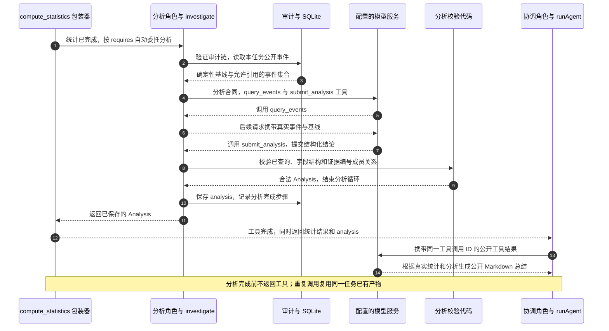

1. `compute_statistics` 在 MPC 完成后不会马上向模型返回。包装器根据计划自动调用 `investigate`，等校验和保存成功才返回 `{...result, analysis}`；这对应此前“缺少 analysis”的修复。
2. 分析前验证完整审计链，并生成确定性基线。统计任务只提供关联本任务的公开审计事件，当前从最近 200 条中筛选、最多提供 80 条。
3. 分析角色必须实际调用 `query_events`，再通过 `submit_analysis` 提交事实、可能原因、建议、不确定性与证据 ID。不能把历史其他任务的失败归因于本轮。
4. 代码检查已查询、数组类型和长度、证据编号非空且不重复，并保证每个编号属于实际允许集合。提交成功立即结束分析循环。兼容最终 JSON 回复的提供商仍执行相同校验，不能跳过查询。
5. analysis 落盘后，工具才向协调模型返回批准统计与分析，模型再生成可读总结。原始记录、私钥与份额不进入该结果，模型内部推理字段也不进入公开回复。
6. 同一任务重复计算或分析会复用已有产物，不重复 MPC 或扣预算。跨任务的新统计仍须重新执行。

**完成条件：**存在有效的已保存 analysis，协调模型返回公开总结。阶段八还会再次核对必需产物。

**失败影响与源码：**模型、结构或证据校验失败时，已保存统计仍可复盘，但本轮失败且不发布成功报告。入口为 `service.ts: compute_statistics/investigate/validateAnalysis`、`model.ts: runAgent`。

### 7.8 阶段八：检查完成条件，签名、加密并交付报告

**目标：**把真实产物绑定为可下载、可复验的报告，再提交完成状态。

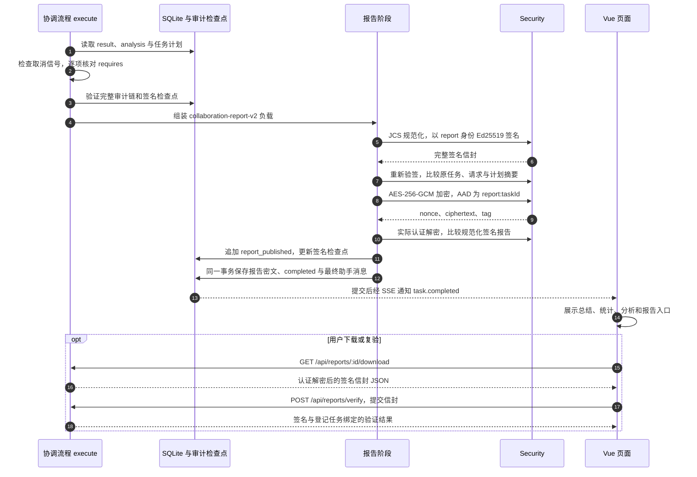

1. `execute` 检查取消信号和 `requires`。本例必须同时有 result 与 analysis，缺少时返回 `contract_incomplete`，模型文字不能补造。
2. 报告负载包含请求、计划、真实统计、分析、总结、时间和解释来源等。report 身份签署 JCS 原文后，代码重新验签并核对原任务绑定。
3. 存储加密使用本机 256 位密钥、12 字节随机 nonce、16 字节标签及 `report:<taskId>` AAD。代码当场认证解密并比较原文；这是**发布前加密往返校验**，不是对已提交数据库文件的磁盘回读验证。
4. `report_published` 审计及检查点先写入，随后 `Store.update` 在同一 SQLite 事务中保存报告密文、completed 状态和最终助手消息，再通知订阅者。检查点文件与数据库没有构成一个跨文件原子事务。
5. 因此，单独看到 `report_published` 还不能断言交付事务成功；应结合 completed、可读报告和 `task.completed`。任何阶段写入失败都需按实际状态排查。
6. 下载返回签名 JSON，而不是存储 AES 密文包。服务端复验还依赖登记公钥与数据库原任务，第 9 章说明其边界。

**完成条件：**报告与最终状态事务提交成功。页面合并完成事件后，整轮才显示完整成功。

**源码入口：**`service.ts: execute/report/verifyReport`、`security.ts: sign/verify/seal/unseal`、`audit.ts: append/verify`、`store.ts: update/report`、`Reports.vue`。

## 8. 三节点统计协议：数值与报文如何对应

### 8.1 从记录到充分统计量向量

对于一个路段上的平均速度指标，节点 i 在批准区间取得有效速度样本集合 R_i，定点倍率 `Q=10000`：

```text
n_i = 本节点有效速度样本数
s_i = Σ round(speed × Q)，对 R_i 中每条有效记录求和
v_i = [n_i, s_i, 0, 0]
```

其他指标复用四分量 `[计数, 总和, 平方和, 分母]` 布局。方差与标准差需要平方和；条件比例需要匹配数与完整候选样本数；总量比值需要分母字段总和。多路段、多指标按批准顺序拼接，通信中不能改变顺序。

去重车辆数先在各节点按 vehicleId 去重，再相加。导入时同一车辆必须归属同一节点，才能避免跨节点重复计车。平均速度则按每条有效速度样本计算，不按车辆数作分母。

### 8.2 从秘密份额到总量与均值

对每个向量分量 k，各节点独立采样随机系数：

```text
p = 2^127 - 1 = 170141183460469231731687303715884105727
f_i,k(x) = (v_i,k + a_i,k × x) mod p
x_A = 1，x_B = 2，x_C = 3

G_k(j) = Σ_i f_i,k(j) mod p
T_k = (3G_k(1) - 3G_k(2) + G_k(3)) mod p

N = n_A + n_B + n_C
S = s_A + s_B + s_C
平均速度 = S / (Q × N)，N > 0
```

例如，假设批准区间中 A 持有 60、40 两条速度，B 持有 20 一条速度，C 无样本，则 `N=3`、`S=1200000`，均值为 40 km/h。C 贡献零统计向量，不是一个零速样本。本例只说明口径，不代表本次执行数据。

一次多项式数学门限为两份，当前实现仍要求三个节点全部完成，并用三个聚合份额重构。随机系数和份额每次重新生成，文档不填虚构固定私钥或份额来冒充真实运行。

### 8.3 不同密码与报文的职责

| 对象 | 保护与校验 | 不能混淆的内容 |
|---|---|---|
| 批准任务 | coordinator Ed25519、query、版本和有效期 | 不等于模型获得原始记录查询权 |
| RSU task.request | mTLS、外层 Ed25519、messageId 和时间 | 统计窗口和消息新鲜性不同 |
| share / aggregate | mTLS、任务、方向、维数、有限域和去重 | shares 是向量，没有逐条独立 Ed25519 信封 |
| 节点回执 | 认证连接内 accepted 与 taskId | 不使用 RSU 的独立签名回执格式 |
| 聚合输出 | vehicle-a Ed25519、请求/query/版本绑定 | 验签与范围复核不等于可验证计算证明 |
| 最终报告 | report Ed25519，加 AES-GCM 存储 | 签名和存储加密职责不同 |

份额以十进制字符串传输和保存，避免 Number 丢失大整数精度。实际 TLS 展示来自 socket 的版本、密码套件、证书与指纹；未导出 TLS 临时流量密钥，也未捕获或伪造逐个握手包。

## 9. 分析、签名报告与可验证范围

### 9.1 分析产物的实际结构

以下是结构定义，不是某次模型输出：

```typescript
interface Analysis {
  facts: string[];
  possibleCauses: string[];
  recommendations: string[];
  uncertainties: string[];
  evidenceIds: number[];
}
```

四类文字数组每类最多 30 项，每项最多 1500 字符。证据数组非空、最多 80 项、整数编号不重复，且全部属于实际查询集合。编号成员校验约束“引用了什么”，不保证每句解释都成立。

分析需区分事实、可能原因、建议和不确定性。例如 `mpc_started` 仅支持“发起调度”，`statistics_completed` 才支持“批准聚合完成”，两者都不能单独证明“报告已经交付”。

### 9.2 报告包含什么

`collaboration-report-v2` 负载包含 taskId、requestId、requestDigest、plan、mode、summary、result、analysis、verification、at 和 explanationSource。

explanationSource 标明模型解释来源。统计任务 result、analysis 为实际产物，verification 可以是 null；发布前报告自验签不等于“用户发起验签任务”对应的 verification 产物。

SHA-256 用于请求摘要和计划绑定比较；Ed25519 签署 JCS 规范化负载原文，应用没有先单独哈希原文再将摘要当作签名载荷。

### 9.3 下载与复验的边界

下载的是**签名信封 JSON**，不是接收者专属加密分享包，也不含存储密钥。页面本机材料通道可另行展示报告加密材料。

`verifyReport` 检查登记 report 身份、密码签名、报告类型、原任务存在、requestId、请求摘要及计划摘要。关联对话被删除后，任务绑定记录和报告移除，此前下载报告不保证继续通过本服务的完整绑定验证。

签名支持来源和完整性判断，不能单独证明原始道路数据真实、参与节点没有作恶、计算具备主动恶意安全，或自然语言解释完全正确。当前未提供外部独立审计参考状态或通用可验证计算证明。

## 10. 辅助时序图：页面观察、日志与追问分支

### 10.1 贯穿全程：公开 SSE、完整材料与 Git 日志

这条通道从页面初始化开始，与八个主流程阶段交错运行，不是报告完成后才开始。

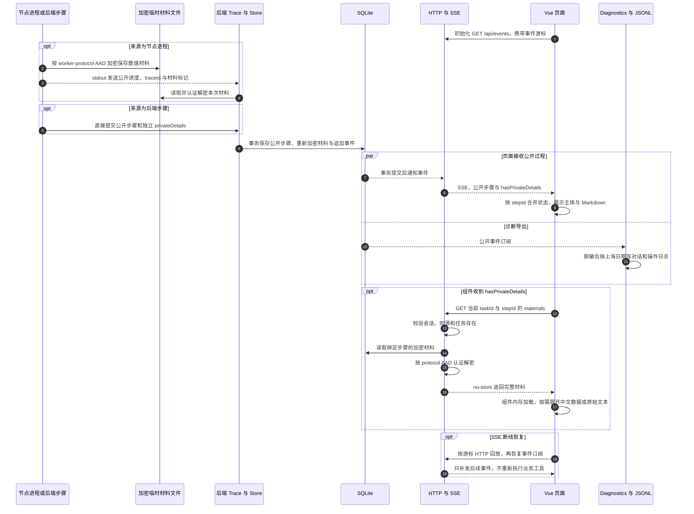

1. Trace 贯穿全程。稳定 stepId 对应步骤创建与更新，页面更新同一步骤状态，不把更新叠成一个新任务。
2. 节点材料在临时目录按 `worker-protocol:<taskId>:<traceId>` AAD 加密。后端读取后重新按 `protocol:<taskId>:<stepId>` 绑定，保存到独立 `protocol_materials` 表。协调器、RSU 和报告材料可直接走 Trace。
3. SSE 只有公开步骤与材料标记，不包含私钥、原始记录或完整份额。`TaskStepCard` 收到标记后即单独加载材料，**当前不是点击详情才发请求**；展开只控制显示。
4. 材料驻留相关组件内存，不写入 localStorage、不自动加入模型上下文或诊断日志。中文字段、份额表格、原始文本和复制用于复盘，未保存的历史瞬时材料不会重造。
5. Diagnostics 订阅公开事件，并记录 API、模型请求状态和其他操作回调；写盘前脱敏，按 Asia/Shanghai 分日，以 runId、sourceId、eventId、conversationId、taskId、requestId 关联。纳入 Git 的是日志文件，不表示运行时自动提交 Git。
6. SSE 是任务/步骤事件流。模型当前整次接收 content 与 tool_calls，不是逐 Token 回复。回放只补事件，不重跑工具、不再扣预算。

**阅读与源码：**先按任务找阶段，再用事件 ID 和证据 ID 核对事实，需要教学数值时读步骤材料。入口为 `service.ts: trace/protocolMaterials`、`mpc/party.ts: progress`、`mpc/runner.ts`、`store.ts: step`、`index.ts: eventStream/materials`、`logging.ts`、`workspace.ts`、`TaskStepCard.vue`。

完整私钥与原始输入对本机观察者可见，因此不能声称对该观察者保密。此通道仍是对话展示功能，不依赖已删除的“安全实验室”页面。

### 10.2 继续提问与执行失败

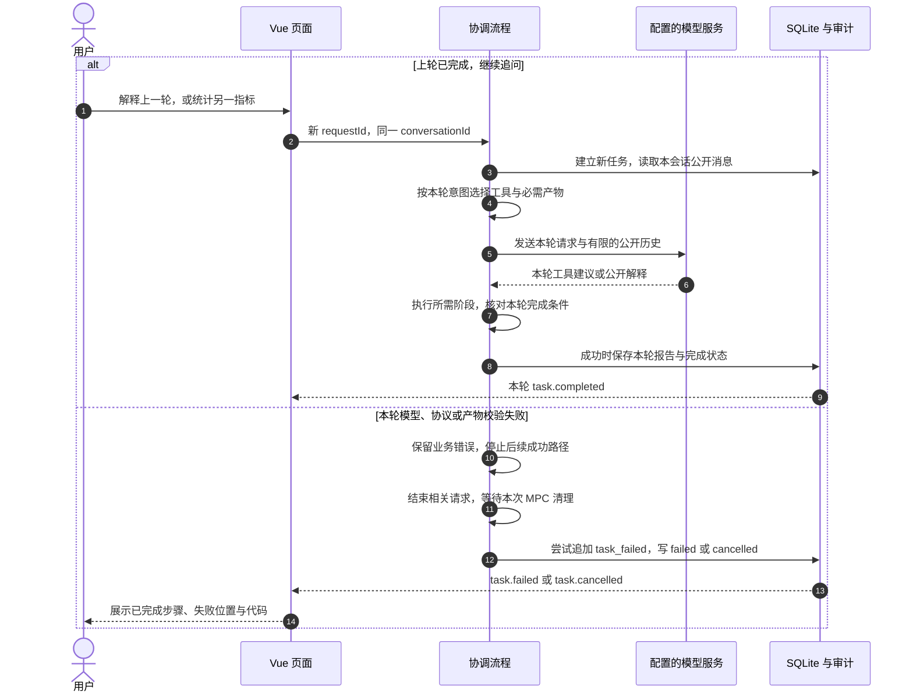

**继续提问：**每条消息建立新的 taskId 与 requestId，复用 conversationId。模型上下文主要是本会话已保存的公开用户/助手消息，不自动携带上轮私密材料。解释型任务通常不重跑统计；新的统计重新规划，按当前时间和版本执行，不能将上轮缓存冒充本轮结果。验签型任务只验证当前会话最近的已有报告。

**执行失败：**已经完成的统计、步骤和审计证据可能保留，但整轮不能显示成功。取消会传播信号并清理子进程；后端重启不自动重放未完成任务。材料加载失败是独立读取失败，应与业务计算失败区分。

**边界与源码：**意图由明确选择或 `planTask` 关键词规则决定，不保证任意一句自然语言都触发期望类型；工具与产物受本轮计划约束。入口为 `planTask`、`service.ts: execute/fail/cancel`、`store.ts: messages/update`、`workspace.ts: send`。

## 11. 状态、异常与执行限制

### 11.1 状态处理

| 情况 | 实际行为 |
|---|---|
| 创建任务 | 保存 queued 状态和用户消息；同一 requestId 的相同请求返回已有任务 |
| 正在执行 | 进入 running；各步骤使用稳定 ID 更新状态并追加事件 |
| 成功 | 必需产物及审计检查通过，报告落盘后变为 completed |
| 模型或工具失败 | 记录类型化错误，任务 failed，不生成缺失产物的成功报告 |
| 用户取消 | 中断请求和协议，标记 cancelled，清理相关资源 |
| 后端重启 | 保留已有数据，将未完成任务及其未完成步骤标记失败，不自动重放副作用 |
| 删除对话 | 先取消排队与执行任务，等待本次 MPC 清理，再原子删除关联应用数据 |

### 11.2 常见错误与含义

| 错误 | 说明 |
|---|---|
| query_budget | 本机查询冷却未结束 |
| unauthorized | 已签名 query、数据版本、用途、参与集合或任务有效期不符合策略 |
| replay_rejected | 同一消息 ID 已被持久化接受 |
| model_unavailable | 模型请求未返回有效结果；公开响应与内部诊断分开保存 |
| analysis_invalid | 未查询、字段类型/长度不正确，或引用了不属于实际查询的证据编号 |
| contract_incomplete | 缺少计划要求的聚合、分析、验签或解释产物 |
| report_missing | 当前范围没有报告，不能执行需要已有报告的操作 |
| signature_invalid / ciphertext_invalid | 签名验证或 AES-GCM 认证解密失败 |
| mpc_timeout / mpc_party_failed | 三方执行未完成，禁止用替代结果发布 |
| conversation_deleted | 已删除会话或请求被重试，拒绝重新创建 |

这些是可能返回的代码类别，不保证每种底层故障都映射为同一个表中代码。嵌套 Effect 错误会解开 FiberFailure，尽量保留原始业务错误；HTTP 只返回公开代码与说明。

### 11.3 当前限制与默认值

| 项目 | 代码中的限制或默认值 |
|---|---|
| 用户请求 | 最长 2000 字符 |
| 未完成任务队列 | 最多 8 个 queued/running 任务 |
| 协作并发 | 最多 2 个独立会话任务；同一会话串行 |
| MPC 并发 | 1 个统计协议，取消时等待其进程清理再释放许可 |
| 模型循环 | 每次 runAgent 最多 7 轮请求、6 次工具调用；规划、协调、分析分别计数 |
| 模型单次请求 | 35 秒超时 |
| 单任务 | 默认 180 秒 |
| 三方执行 | 默认 20 秒，可配置；节点单次收发/等待还有内部超时 |
| 查询预算 | 默认全局 local-user 冷却 30 秒，持久化保存 |
| RSU 外层新鲜性 | 消息时间与当前时间相差不超过 60 秒 |
| 签名任务有效期 | 当前生成约 90 秒，授权代码还检查有效期范围 |
| 数据与查询规模 | 单次最多 6000 条导入记录、2 MiB 请求体；1—8 路段、1—12 指标、最长 31 天 |
| 节点消息 | 换行分隔 JSON，接收长度上限 65536 字符 |
| 前端日志 | 最多暂存 50 条；每批 1～8 条，服务端每分钟最多接受 120 条 |

此处的“60 秒任务窗口”和“60 秒消息新鲜性”含义不同，不能互相替代。

## 12. 数据、接口、时区和删除语义

### 12.1 核心持久化对象

| 对象 | 位置或表 | 说明 |
|---|---|---|
| 会话和消息 | conversations、messages | 对话标题、时间、用户请求和完成后的助手说明 |
| 任务与步骤 | tasks、steps | 计划、状态、批准结果、执行主体、方向、公开协议详情 |
| 完整实验材料 | protocol_materials | 独立认证加密，绑定任务和步骤 |
| 公开追加事件 | events | 步骤与任务变化，支持 SSE 游标回放 |
| 报告 | reports | 以任务 AAD 加密的签名信封 |
| 安全审计 | audit、audit.checkpoint.json | 哈希链与 report 身份签署的检查点 |
| 去重与预算 | replay、budgets | 消息 ID 去重与查询冷却 |
| 删除标记 | deleted_conversations、deleted_requests | 保留最小会话、任务与请求标识，防止旧请求恢复 |
| 身份文件 | runtime-ts/pki/ | 本机 CA、节点证书、私钥、输入密钥、分版本车辆快照和存储密钥 |
| 模型设置 | model-settings.enc.json | 使用存储密钥加密的配置 |
| 诊断日志 | logs/conversations、logs/operations | 脱敏 JSONL，按要求纳入 Git |

`events` 和 `audit` 有禁止常规 UPDATE/DELETE 的触发器。数据库防改写机制仍在本机权限与实现信任范围内，不是外部不可篡改存证系统。

### 12.2 主要实际 API

| 方法与路径 | 功能 |
|---|---|
| GET /api/session | 建立本机 HttpOnly、SameSite=Strict 会话 Cookie |
| GET /api/overview | 公开概览、会话、任务与登记节点 |
| GET /api/telemetry | 已登记数据目录、版本、路段与数量 |
| GET /api/telemetry/records | 同源读取当前完整编辑快照 |
| POST /api/telemetry | 导入记录；编辑保存带 baseVersion 以检查版本冲突 |
| POST /api/tasks | 校验并提交新任务 |
| GET /api/tasks/:id | 读取任务及独立步骤 |
| POST /api/tasks/:id/cancel | 取消任务 |
| GET /api/conversations/:id | 读取会话、消息和任务摘要 |
| DELETE /api/conversations/:id | 取消相关任务并删除关联应用记录 |
| GET /api/events、GET /api/events/replay | SSE 增量和 HTTP 回放 |
| GET /api/tasks/:taskId/steps/:stepId/materials | 认证同源读取完整实验材料 |
| GET /api/reports/:id、GET /api/reports/:id/download | 读取或下载解密后的签名报告 |
| POST /api/reports/verify | 验证签名及登记任务绑定 |
| GET /api/evidence、GET /api/evidence/analysis | 安全事件与证据分析 |
| POST /api/audit/verify、POST /api/audit/checkpoint | 审计验证与签名检查点 |
| GET /api/model-settings、PUT /api/model-settings | 模型公开设置和保存配置 |
| POST /api/client-logs | 认证、同源、受限频率的前端诊断上报 |

除建立会话、健康检查等明确入口外，API 要求本机会话；写操作检查 Origin 和 Sec-Fetch-Site。完整材料 GET 也增加同源来源检查，响应设置 no-store。当前是本机应用会话，不是已实现的多用户身份与租户隔离平台。

### 12.3 时间显示

内部任务和签名对象使用 Unix 毫秒时间，显示层统一转换为 `Asia/Shanghai`。侧栏“今天 / 昨天 / 过去 7 天”按上海日期分组并定时更新。新增日志格式示例：

```json
{
  "timestamp": "2026-10-22T20:00:00.000+08:00",
  "timeZone": "Asia/Shanghai"
}
```

以上只是格式示例，不是某次执行耗时或实际日志截取。历史 UTC 行保持原样，标准 ISO 解析器仍可读取。签名原文不会因页面时区显示而改写。

### 12.4 删除对话的范围

左侧垃圾桶按钮经过页面确认后，后端移出排队任务、取消执行任务，等待相关计算清理，再在同一事务中删除会话、消息、任务、步骤、报告及完整材料，并追加 `conversation.deleted`。

其他窗口收到事件后清理对应缓存和当前选择；当前对话被删后回到新对话。迟到请求使用选择版本防止重新显示，报告页面也清理已删除任务的内容。重复删除具有幂等结果。

Git 诊断日志、安全审计和数据库追加事件继续保留。公开事件查询会过滤已删除会话的旧内容；删除请求与任务的最小标识继续占用，因此旧 requestId 不能重新执行。此功能不清除 Git 历史，也不构成针对磁盘残留或所有留存副本的数据擦除。

## 13. 可读对话展示与日志复盘

### 13.1 用户如何阅读一次协作

1. 从“任务管家”的概览了解任务类型、进度和参与者。
2. 按顺序阅读每个独立主体的消息，识别计算节点 A/B/C 及不同 Agent。
3. 直接查看速度、发送去向、回执、份额表格、校验状态和最终均值。
4. 需要学习协议时展开“执行经过”和“协议、报文与校验数据”。
5. 需要核对完整实验数值时展开“密钥、原始数据与完整份额”，切换中文视图或原始 JSON，并复制原文。
6. 通过证据链接回到审计页面，通过报告入口查看签名信封和服务端绑定验签。

没有顶部导航栏，历史记录、模型设置和运行概览在左侧。正文使用整个页面滚动，输入框底部停靠；详情不会新增一个截断长材料的内部纵向滚动区。

### 13.2 三类记录如何区分

| 记录 | 用途 | 不能替代什么 |
|---|---|---|
| 页面任务/步骤事件 | 展示开始、更新、完成、失败和消息方向 | 不能独立替代密码验证 |
| 安全审计与检查点 | 核对事件链与参考状态，关联身份和任务事实 | 不能抵抗完全控制本机参考状态和私钥的对手 |
| 诊断 JSONL | 排查 API、模型、前端、任务和存储错误 | 不能代替审计、签名报告或不可篡改存证 |

日志使用 runId、sourceId、eventId、conversationId、taskId、requestId 关联。模型请求日志记录状态、耗时和失败原因，不记录原始响应正文或内部推理。步骤正文与公开协议信息会经脱敏输出，私密材料表不进入该通道。

日志补写依赖运行目录中的导出游标；崩溃恢复可能重复少量记录，可用 sourceId + eventId 去重。已经写入 Git 历史的对话内容不会随页面删除而消失。

## 14. 验证依据与功能边界

当前测试源码包括：

- `core.test.ts`：契约、Markdown、真实三节点 mTLS/MPC、报告验证、已删除接口返回 404、事件回放、材料隔离、模型工具及完成条件；
- `logging.test.ts`：脱敏、HTTP 失败诊断、日志补写、上海午夜和非上海系统时区；
- `conversations.test.ts`：删除时取消任务、关联清理、审计保留、重启和旧请求不恢复、MPC 取消后的后续计算；
- `statistics.test.ts`：受控指标、真实窗口筛选、数据导入、动态车辆归属、三节点向量统计与模型规划；
- `vehicle-editor.test.ts`：车辆数据编辑组件的数值输入与保存交互。

“有测试源码”和“某次测试已通过”是不同事实。本文更新仅进行源码与文档对照，不新增真实模型调用、道路采样、性能实验或跨平台验证结论。展示运行时应以对应任务和测试输出为证据。

## 15. 威胁模型、已知边界与后续改进

### 15.1 当前结论所依赖的前提

| 问题 | 当前能支持的结论 | 限制 |
|---|---|---|
| 节点身份 | 认证连接与登记证书、公钥绑定 | 本机 CA、注册表及私钥可信 |
| 消息完整性 | TLS 及指定对象签名可以发现相关改动 | 不证明发送者提供的业务数值真实 |
| 节点输入隐私 | 在被动假设与不额外开放材料的协议视角下，节点持有本地输入、对应份额及批准输出 | 教学材料通道会把原始输入、私钥和份额展示给本机观察者 |
| 三方统计 | 固定范围内真实计算并验证输出绑定 | 没有主动恶意安全、输入真实性证明或通用 MPC 能力声明 |
| 审计 | 可核对哈希链与当前签名检查点 | 参考状态、数据库与密钥都在本机 |
| 模型解释 | 只能使用批准工具和真实证据编号 | 编号正确不意味着自然语言推断一定成立 |
| 可用性 | 有队列、超时、取消、冷却和资源清理 | 不等同于生产高可用或抗拒绝服务系统 |

虽然各节点按照代码只解密本节点车辆快照，但它们同处一个宿主机、使用同一操作系统账户和可访问的本地目录；进程拆分不是强文件权限隔离。页面暴露签名私钥后，能看到该私钥的观察者也不能再被纳入签名抗伪造的保护对象。公开均值仍有推断风险，查询冷却不等于差分隐私。

### 15.2 下一阶段可以优化的方向

以下均为**后续工作，当前未实现**：

| 优先级 | 改进方向 | 需要补充的实现 |
|---|---|---|
| 高 | 接入可信采样源 | 实时采样接入、来源证明、时钟校准、重复/缺失数据质量检查；导入数据的时间筛选与样本加权已实现 |
| 高 | 区分教学观察与受限运行模式 | 可关闭密钥展示、材料访问授权、日志/事件留存与清理策略 |
| 高 | 加强节点与密钥隔离 | 独立账户或主机、受限文件权限、密钥轮换和证书禁用流程 |
| 中 | 更强协议安全 | 主动恶意模型、输入承诺/范围证明或经评估的成熟 MPC 实现 |
| 中 | 降低公开结果推断风险 | 差分隐私机制、明确的隐私预算与效用评价 |
| 中 | 外部审计参考状态 | 外部保管检查点、独立验证与抗回滚设计 |
| 中 | 多 Agent 效果评估 | 与确定性流程、单 Agent 基线比较证据正确率、成功率和成本 |
| 按需 | 动态协议节点、多 RSU、多用户 | 车辆数量已可配置；扩展计算参与集合仍需重评协议、授权、资源限制与故障模型 |
| 按需 | 模型逐 Token 流式回复 | 模型流式协议、工具片段装配、取消和界面增量渲染 |
| 按需 | 接收者专属报告分享 | 接收者身份、密钥封装和导出格式；当前无 RSA-OAEP 分享功能 |

原方案中的 4～6 周工期、20～30 个模型评估任务、X25519/HKDF 教学实验、联邦学习和区块链等应作为可选规划，不能作为本版本完成结果或实测结论。

## 16. 开发运行与源码索引

### 16.1 本机开发

以下命令从本文件所在的项目总目录进入源码目录后执行：

```powershell
Set-Location -LiteralPath './source code'
bun install --frozen-lockfile
if (-not (Test-Path -LiteralPath '.env')) {
    Copy-Item -LiteralPath '.env.example' -Destination '.env'
}
bun run dev
```

默认访问 `http://127.0.0.1:5173`，Vite 将 `/api` 代理到默认 `127.0.0.1:8000`。前端修改通过 HMR 生效，后端源码变化通过 Bun watch 重启；SQLite、身份、设置与已完成记录继续保存。

构建运行使用 `bun run build` 和 `bun run start`，默认由 `http://127.0.0.1:8000` 同源提供页面与接口。后端热更新有短暂中断；已发生的计算、预算扣减和签署不会被自动重放。

应用运行数据默认位于 `runtime-ts/`，应用日志位于 `logs/`。Codex 的辅助脚本、计划和检查记录统一放在项目总目录的 `codex_files/`，不作为项目运行依赖或混入源码根目录。

### 16.2 关键源码索引

以下链接相对于本文件所在目录。

| 阅读主题 | 源码与入口 |
|---|---|
| 版本和依赖 | [package.json](source%20code/package.json)、[bun.lock](source%20code/bun.lock) |
| 总体使用说明 | [README.md](source%20code/README.md)、[architecture.md](source%20code/docs/architecture.md) |
| 任务类型、计划与 Schema | [shared/index.ts](source%20code/packages/shared/src/index.ts)：planTask、CreateTaskSchema、Analysis 等 |
| 上海时区 | [shared/time.ts](source%20code/packages/shared/src/time.ts) |
| 查询与车辆数据契约 | [shared/statistics.ts](source%20code/packages/shared/src/statistics.ts) |
| 统计方案与数值口径 | [statistics.ts](source%20code/apps/server/src/statistics.ts)：validateQuery、resolveRelativeQueryTime、localVector、finishVector |
| 版本化车辆快照 | [telemetry.ts](source%20code/apps/server/src/telemetry.ts)：Telemetry.import、catalog、readTelemetry |
| API 与 SSE | [server/index.ts](source%20code/apps/server/src/index.ts)：startServer、route、eventStream |
| 协调、分析与报告 | [service.ts](source%20code/apps/server/src/service.ts)：submit、prepareStatistics、compute、investigate、execute、verifyReport |
| 身份与密码 | [security.ts](source%20code/apps/server/src/security.ts)：Security、authorizeTask、canonical、seal、unseal |
| 网关和认证传输 | [transport.ts](source%20code/apps/server/src/transport.ts)：gateway、exchange、checkPeer |
| 三方进程管理 | [mpc/runner.ts](source%20code/apps/server/src/mpc/runner.ts)：MpcRunner.run、waitForTask |
| 节点真实协议 | [mpc/party.ts](source%20code/apps/server/src/mpc/party.ts) |
| 有限域算法 | [mpc/field.ts](source%20code/apps/server/src/mpc/field.ts)：PRIME、polynomialShares、reconstruct |
| 模型调用与工具 | [model.ts](source%20code/apps/server/src/model.ts)：ModelSettings、runAgent |
| 数据与删除事务 | [store.ts](source%20code/apps/server/src/store.ts)：create、step、events、deleteConversation |
| 审计与诊断 | [audit.ts](source%20code/apps/server/src/audit.ts)、[logging.ts](source%20code/apps/server/src/logging.ts) |
| 页面状态与消息 | [workspace.ts](source%20code/apps/web/src/stores/workspace.ts)、[TaskInteraction.vue](source%20code/apps/web/src/components/TaskInteraction.vue)、[TaskStepCard.vue](source%20code/apps/web/src/components/TaskStepCard.vue) |
| 昵称、头像与中文数据 | [conversation.ts](source%20code/apps/web/src/conversation.ts)、[ActorAvatar.vue](source%20code/apps/web/src/components/ActorAvatar.vue)、[ReadableData.vue](source%20code/apps/web/src/components/ReadableData.vue) |
| 历史删除与报告页面 | [AppSidebar.vue](source%20code/apps/web/src/components/AppSidebar.vue)、[Reports.vue](source%20code/apps/web/src/views/Reports.vue) |
| 核心验证源码 | [core.test.ts](source%20code/apps/server/tests/core.test.ts)、[logging.test.ts](source%20code/apps/server/tests/logging.test.ts)、[conversations.test.ts](source%20code/apps/server/tests/conversations.test.ts) |
| 开发热更新 | [scripts/dev.ts](source%20code/scripts/dev.ts)、[vite.config.ts](source%20code/apps/web/vite.config.ts) |

本文的时序、参数、数据边界和功能状态以以上源码为依据。后续若修改参与集合、统计语言、窗口筛选、密钥展示或报告合同，应同步更新示例流程、时序图和安全边界说明。
