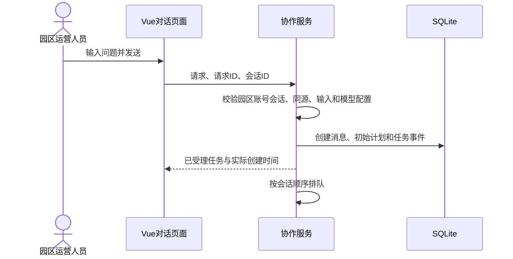
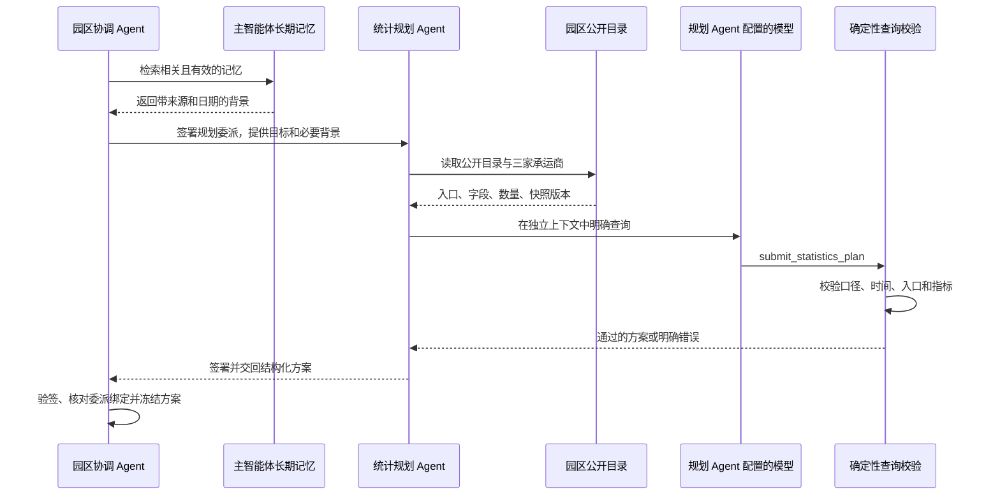
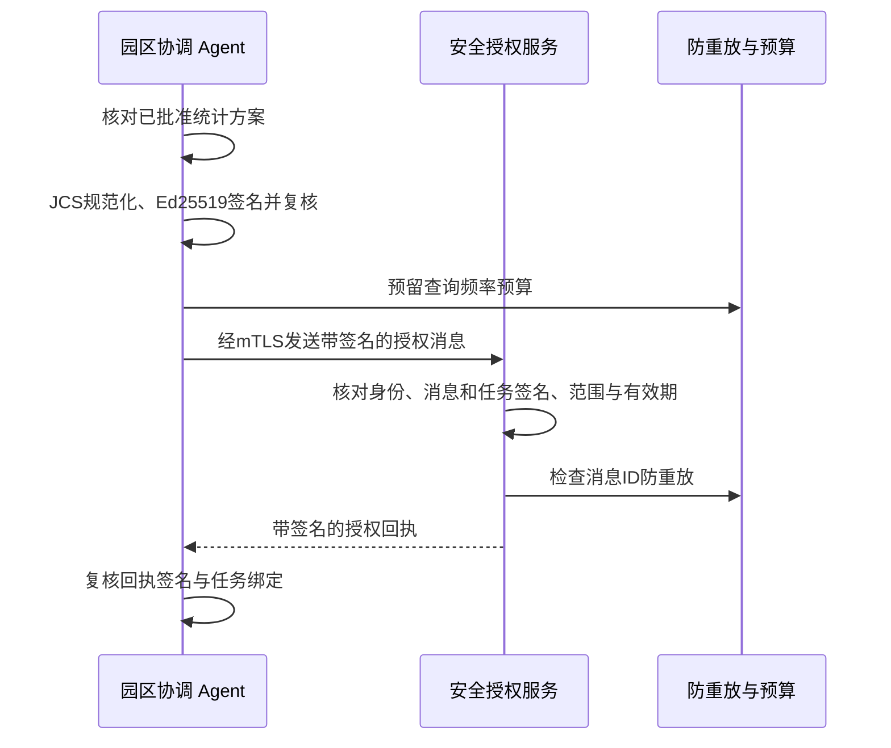
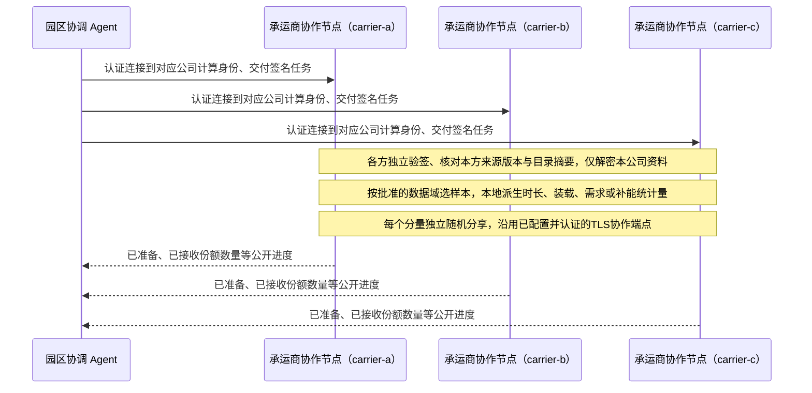
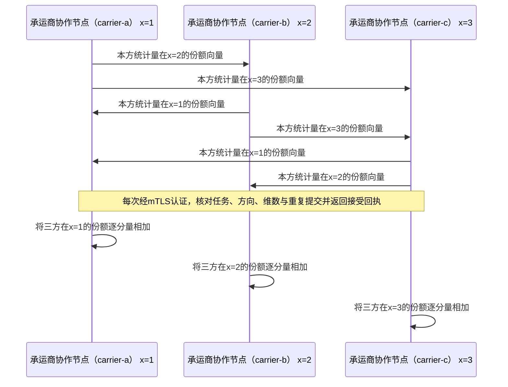
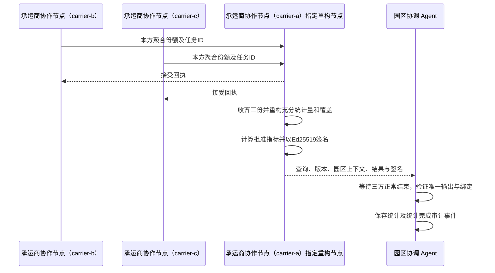
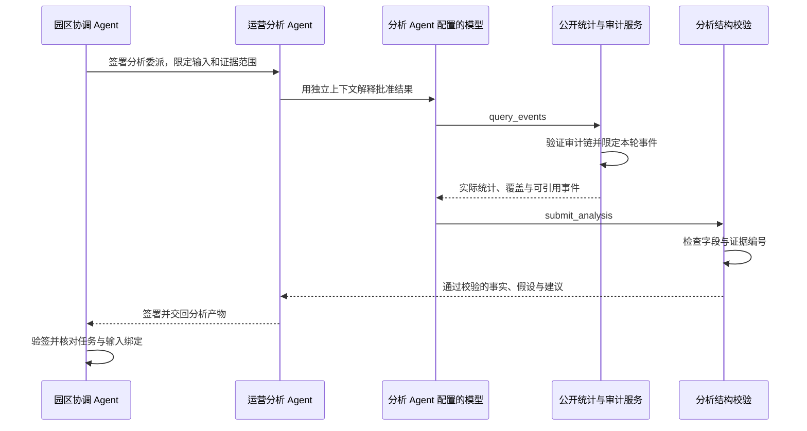
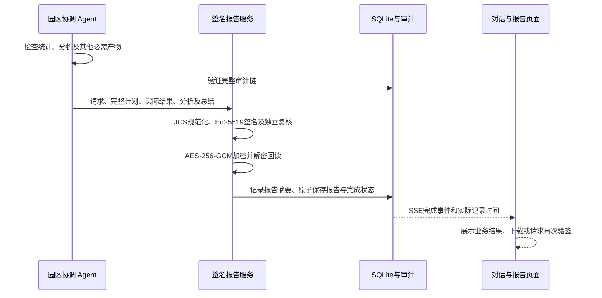

# 物流园区三家承运商联合运营分析：项目介绍与功能分析

统一名称与概念定义见[系统术语与登记身份](docs/terminology.md)。

VECTRA v2.0.0 · `v2.0.0` 分支 · 2026-10-31 · 中国上海时间

本文依据当前Vue/Bun/TypeScript代码说明业务口径与执行过程。时序图表示代码实现的成功路径；本机集成测试使用测试专用数据及模型响应，不代表现场采集、真实外部模型服务或现场跨企业部署验收。本轮增加园区与企业独立部署和第一批 A/B/C/D/G 经营台账，使用方式见[分端部署](docs/deployment.md)与[经营台账](docs/business.md)。

界面基础控件统一采用 Element Plus，中文语言、主题色、表单、按钮、提示与表格由全站公共组件维护；对话角色、协议材料和公式使用对应业务组件。

## 1. 业务目标与落地价值

园区与三家承运商需要共同了解：车辆何时到达、入口排多久、核验多久、作业区是否拥塞、整个车次何时完成，以及已完成运输行程用了多少电。园区据此人工评估预约错峰、核验与装卸资源安排，并按相同口径复核改善前后的运营表现。

系统的价值是让三家承运商按一致口径形成联合统计并保留任务、版本、签名和证据，使结果可追溯。承运商在各自节点处理原始车次，协议交换统计量份额。模型负责把自然语言组合成受控指标，并解释真实返回结果，不能代替密码验证或任意编写统计程序。

| 运营决策 | 可用证据 | 当前结果能支持什么 | 仍需补充什么 |
|---|---|---|---|
| 调整预约进园时段 | 到达车次、预约准点率、平均排队及超时比例 | 找到应进一步核查的入口与到达批次 | 分时段分别查询、现场核验预约规则与执行情况 |
| 安排核验资源 | 入园核验时长及入口排队 | 区分排队与核验服务时间 | 实际通道数、值守与异常处置记录 |
| 安排作业资源 | 场内待作业时长、作业时长和周转 | 区分待作业与实际作业耗时 | 工位、班次、货物类型与设备记录 |
| 复核运输用电 | 有效已完成车次的总电耗、单车次均值和百公里电耗 | 按明确车次集合观察运输用电表现 | 可信电量计量、车型/载荷及可比线路 |
| 复核运营改善 | 前后区间的签名报告、同口径指标与覆盖情况 | 保留可核对的描述性前后对比依据 | 控制季节、业务量、车型等差异，不能直接宣称因果或节省金额 |

当前没有自动预约优化器、自动资源排班、因果实验、现场采集或柴油及碳排放换算功能。用电是电能指标，不能把缺失电耗的车辆当成零耗能车辆。

## 2. 三家承运商与车次模型

| 承运商编号 | 登记名称 | 业务含义 |
|---|---|---|
| `carrier-a` | 承运商A协作节点 | 承运商A持有的车次及车辆 |
| `carrier-b` | 承运商B协作节点 | 承运商B持有的车次及车辆 |
| `carrier-c` | 承运商C协作节点 | 承运商C持有的车次及车辆 |

三方标识和绑定固定，名称可以修改；车辆数量不固定。一次进园对应一个唯一 `visitId`，同车重复进园产生不同车次。导入必须明确承运商，不再按车牌号散列确定企业归属。车次ID全局唯一；同车同一到达时间也不能通过更换ID重复导入。

界面、车辆、车次、登记表、证书名称与签名中的参与者统一使用 `carrier-a/b/c`，不再保留旧密码身份。一家承运商节点可托管多辆车，不另设一套“独立计算身份”。

升级采用显式身份迁移：重新生成证书机构、节点证书及签名密钥，认证解密并重新加密保留的园区、车辆、车次和模型配置。旧对话、报告、协议材料、审计与对应诊断日志清空，新审计链记录迁移完成事件。旧凭据和旧签名不继续使用，也不把旧协议历史改写成新身份执行过的记录。日常修改企业名称仍只更新登记元数据，区别于这次身份重新签发。

系统共有八个实际登记身份，其中三个为 LLM Agent：一级“园区协调 Agent”是主智能体，统一管理长期记忆、委派专项任务并复核交付；二级“统计规划 Agent”“运营分析 Agent”分别接受规划和分析委派，具有独立上下文、受限工具和可分别配置的模型，但不持有长期记忆。二级另有三家承运商协作节点，承担真实数据处理与隐私聚合；三级为安全授权服务和签名报告服务。只有使用大模型的身份添加 Agent 后缀。对话头像、昵称和消息来源均读取当前登记表，模型服务不额外成为对话角色。Agent 详情展示职责、工具、独立模型配置和真实执行记录；仅主智能体详情提供长期记忆管理。具体设计见 [Agent 工作组与长期记忆](docs/agents.md)。

车辆档案与进出园事件分开维护。企业端固定当前公司，不允许切换为竞争方；“车辆与车次”的车辆档案页签仅维护本方的车牌号、车型、动力和额定载重，不选择入口。手动每次只新增一辆，保存或取消后再继续新增。已保存档案默认只读，在车辆基础信息处点击“修改车辆信息”进入编辑，可以取消修改，保存后恢复只读。车牌是车辆的唯一标识，省份简称、发牌机关字母分别选择，再填写剩余号码；前后端共用普通、新能源及挂车号牌的格式校验，统一大写与分隔符，同一完整车牌不能重复建档或归属多家承运商。旧档案已有真实车牌时自动关联当前车次，未知车牌须补录；不改写已冻结的历史快照。

“园区车辆”页按最近车次展示已入园、作业中、作业已结束、已离园，以及历史排队与暂无车次状态，可按承运商、状态与多条入口筛选。车辆档案页只添加和维护车辆基础信息，不登记入园、不生成车次或入园时间，也不提供入园跳转。建档与实际进园分别操作，状态以已发布车次为依据，不代表实时定位。

车次登记重构为“入园登记、在园作业、离园记录、全部记录”四个工作区。入园登记先选择本方已建档车辆或填写临时车牌，核对承运商、实际入口和时间，必要时补充预约、到达与核验信息。待确认表单与真实记录分离，完整信息通过校验并确认保存后，才产生在园记录和入园时间。默认时间由服务端在确认时记录，不能在打开页面、选车、预填或填写未完成时提前生成。

生命周期按“入园 → 开始作业 → 结束作业 → 离园”推进，各次操作直接保存本车次，入口持续沿用，默认使用服务端当前上海时间。在园作业负责开始与结束作业；“离园记录”用于确认离园，默认列出已结束作业且尚未确认离园的车次，仅展示离园时间，显式确认后保存并转入已确认列表，完整时间轴在“全部记录”查看。未离园车辆不能重复入园；再次入园只带入上次车辆与入口，仍需核对完整信息后确认。离园时的完整行程里程与电耗在可选折叠区填写。历史更正只修改所选记录，车牌、承运商和车次编号保持原样；目标记录变化时阻止过期更正，其他车辆更新可安全合并。历史文件在全部记录中先预览后追加，不覆盖现有记录，也不补造事件时间。切换角色与页签保留待确认信息、更正与导入预览。园区公共配置位于“园区车辆”页，模型配置统一位于 Agent 详情。

删除对话只清理该对话及关联任务、报告、协议材料和 Agent 执行记录，长期记忆独立保留。记忆正文、来源编号、启用与置顶状态、有效期和引用计数均不随删除对话而改变；来源对话已删除时，详情页显示说明，记忆仍可独立检索和管理。

| 字段 | 含义及规则 |
|---|---|
| `visitId`、`carrierId`、`vehicleId`、`road` | 唯一车次、明确承运商、规范化后的完整车牌号、入口，均必填 |
| `arrivedAt` | 到达入口队列的真实时间，必填 |
| `gateStartedAt`、`enteredAt` | 开始入园核验、完成入园 |
| `readyAt`、`serviceStartedAt`、`serviceEndedAt` | 到达作业等候区、开始作业、结束作业 |
| `departedAt` | 实际离园；缺少时视为快照中未完成车次 |
| `appointmentStart`、`appointmentEnd` | 成对填写的预约窗口；它是计划时间，可在未来 |
| `distanceKm`、`energyKwh` | 已离园车次完整运输行程的里程、电耗增量，可缺失 |

时间支持Unix毫秒或严格ISO日期时间，未注明时区按上海处理。实际事件不能在未来，提供的时间必须按生命周期顺序，单车次最长31天。未知端点留空，不凭当前时刻推断结束，不将累计仪表值直接相加。

配置及导入均检查 `baseVersion`，发布完整的新不可变快照。三方记录用各承运商协作节点自己的输入密钥及版本AAD认证加密。模型只看到公开目录，不看到明细。配置改名也生成新版本，正在执行的任务及报告保持原版本和名称。

## 3. 统计范围与分母

查询必须包含 `dataset=park_visits`、道路、上海起止时间、指标和 `cohort`：

- `arrivals`：按 `start <= arrivedAt < end` 选车次，包含尚未离园车次，适合观察到达批次。
- `departures`：按 `start <= departedAt < end` 选已离园车次，适合观察完成吞吐。

这是选取车次的时间，完整车次时长及行程电耗可能跨出该区间。结果使用导入快照中的已知事件，不假装是实时现场状态，也不是历史时刻状态重放。

| 指标或字段 | 计算方式 | 有效车次 |
|---|---|---|
| 车次数 | `count` | 满足本指标条件的所选车次 |
| 车辆数 | `vehicle_count` | 在道路内去重车辆；同车固定归属一家承运商 |
| `queueMinutes` | 到达入口队列至开始核验 | 两个端点齐全 |
| `gateMinutes` | 开始核验至完成入园 | 两个端点齐全 |
| `yardWaitMinutes` | 到达作业等候区至开始作业 | 两个端点齐全；不把园内行驶时间都算成等待 |
| `serviceMinutes` | 开始至结束作业 | 两个端点齐全 |
| `turnaroundMinutes` | 到达入口队列至离园 | 已离园且端点齐全 |
| 完成率 | `ratio`，条件 `completed == 1` | 所选全部车次 |
| 预约准点率 | `ratio`，条件 `appointmentOnTime == 1` | 有完整预约窗口的车次；到达落在起点含、终点不含的窗口内 |
| 排队超时比例 | `ratio`，如 `queueMinutes > 30` | 具有完整排队端点的车次 |
| 总用电、平均每车次用电 | `sum/mean energyKwh` | 提供完整行程电耗的已离园车次 |
| 百公里电耗 | `sum energyKwh / sum distanceKm × 100` | 里程和电耗同时有效，分母为零则无数据 |

时长单位为分钟：

$$
w_{\mathrm{queue}}=\frac{t_{\mathrm{gateStart}}-t_{\mathrm{arrival}}}{60000},\qquad
w_{\mathrm{turnaround}}=\frac{t_{\mathrm{departure}}-t_{\mathrm{arrival}}}{60000}.
$$

各方先产生本地计数与总和，再按全部有效车次计算均值：

$$
\bar w=\frac{S_A+S_B+S_C}{N_A+N_B+N_C}.
$$

这不是三家承运商均值的简单平均。缺失字段不补零，比例分母也不是完整目录总车次。每条道路返回总车次、已完成、未完成、有数据的承运商数；三方都参加协议不代表三家都有该时段数据。各道路车辆数不能直接相加。

园区固定为东入口、南入口、西入口、北入口，每轮可组合查询1—4个入口、12个指标，时间跨度最多31天。支持计数、去重、求和、均值、总体方差和标准差、条件比例、总量比值；不支持任意SQL/代码、最值、中位数、分位数或跨企业订单匹配。

## 4. 示例请求与八阶段

假设已导入相应日期的真实车次，并保存可用模型配置，示例请求为：

> 统计东入口2026年10月23日到达的车次数、车辆数、平均排队时长、排队超过30分钟的比例、平均周转时长和总用电量，保护三家承运商输入并生成签名报告。

以下各图只描述实现，不预设结果数值。对话中每条消息标注以下八阶段之一，节点可在同一阶段并行发送多条消息，不把多项任务叠成一张卡片。

时序图还包含大模型服务、校验模块、数据库等实现组件；它们不是额外的登记角色。园区协调 Agent 的规划调用、分析调用和计算调度均使用同一个“园区协调 Agent”登记身份。

### 阶段一：请求受理

系统先确认有可用模型配置，登记请求和任务，避免相同请求ID重复执行。此时只确定任务类型及必须交付统计和分析；最终时间、指标和快照尚需下一阶段批准。不同会话可并行推进，但MPC执行位置串行使用。失败或取消不会显示为成功交付。

### 阶段二：查询规划与范围冻结

主智能体先检索相关长期记忆并签署委派，统计规划 Agent 使用独立配置的模型与上下文将问题组合成数据型查询，不能执行任意代码。子智能体不持有长期记忆，只使用本次提供的相关背景；产物由自身签名，主智能体验签并核对绑定。后端统一解释明确的相对时间与自然日，检查非未来区间、31天限制以及道路和字段。示例使用到达口径，未离园车次仍进入覆盖计数。名称与数据版本一同冻结，后续导入或改名不影响本轮。

### 阶段三：签名任务与安全授权

JCS（JSON Canonicalization Scheme，JSON规范化方案）统一签名内容，Ed25519提供签署来源与完整性检查。mTLS（mutual Transport Layer Security，双向传输层安全）通过TLS 1.3相互认证并加密连接。安全授权服务的授权回执只表示授权请求已接受，不表示统计或报告完成。频率预算限制重复查询，不是差分隐私预算证明。

### 阶段四：三个承运商协作节点准备与本地派生

AES-GCM（Advanced Encryption Standard in Galois/Counter Mode，GCM模式高级加密标准）认证解密时检查密文与版本AAD。各承运商本地计算排队、核验、作业和周转差值，缺失端点不补零。随后形成每指标四分量；实际车次每组另有四个覆盖分量，预约计划两个，经营台账三个。新部署同时冻结三家公司各自来源版本，原始业务与私钥留在企业端。空数据节点仍参与协议，贡献零计数，不伪造车次。公开端点只用于寻址，后续仍需验证证书。

### 阶段五：秘密份额交换与聚合

MPC（Multi-Party Computation，多方计算）在当前实现中使用Shamir秘密分享聚合统计量。每个秘密分量使用独立随机数：

$$
f_{i,k}(x)=(s_{i,k}+a_{i,k}x)\bmod p,\qquad p=2^{127}-1.
$$

其中 (i) 是提供输入的承运商，(k) 是统计分量，(x) 对应接收节点。每方保留给自己的一份，发送其余两份；接收方只接受登记对端及相同任务的向量，再计算 (G_k(x)=\sum_i f_{i,k}(x)\bmod p)。份额消息不携带原始车次。接收回执是TLS连接内的任务确认，不应与第三阶段的授权回执混为一谈。

### 阶段六：重构、签署并复核输出

重构使用 (T_k=(3G_k(1)-3G_k(2)+G_k(3))\bmod p)。计数、总和、平方和及分母转换成批准指标，分母为零或没有对应数据时明确无数据。园区协调 Agent 核对签名、查询、数据版本、名称上下文、指标单位、有效车次和覆盖一致性。它验证来源与范围，不是独立重算证明。此阶段完成后已有统计，分析或交付仍可能失败。

### 阶段七：运营分析与证据约束

主智能体把分析交给运营分析 Agent，后者使用自己配置的模型和独立上下文，只得到批准的联合结果、公开事件和必要背景。分析产物由子智能体签署，主智能体核对来源与本次任务的绑定。后端检查引用编号来自实际查询；三家有多少数据、多少车次未完成等事实由代码补充。模型可提出预约错峰或作业资源核查建议，但不执行调度，也不能仅凭相关性宣称某项措施改善了运营。分析失败时保留已经产生的统计，任务不发布成功报告。

### 阶段八：报告交付与后续验签

报告同时绑定原始请求摘要、完整统计计划、数据版本、承运商名称、实际结果和分析。独立验签发现内容修改或任务串用；之后改名不改变历史报告的签名。SHA-256（Secure Hash Algorithm 256-bit，256位安全散列算法）审计链关联前后事件。签名与审计完整性均不证明导入事件真实或模型解释正确。

## 5. 可读交互、日志与恢复

主页面采用AI对话形式，正文使用窗口滚动，没有顶部导航或首页内嵌纵向滚动条。各登记身份消息独立呈现，按三级职责分组，三家承运商使用不同头像和当前登记名称；只有不同登记主体间的通信标记收发方向。每条消息展示八阶段、实际时间、协议全称、目的、原因和后续步骤；数学公式经KaTeX渲染，原始报文和签名不因可读说明而改写。历史报告的业务名称与任务上下文仍采用冻结版本。

实时SSE与HTTP游标补发恢复事件，后端监听源码重启保留SQLite和快照；未完成的副作用任务不会自动重做。取消及删除会先停止相关进程，再移除应用中的对话、任务和报告；追加审计与Git诊断日志保留。

三类数据的用途不同：运行数据库保存任务与加密材料，签名报告交付本轮结果，Git日志保存脱敏对话与操作排障信息。车次明细、车辆/车次ID、原始事件、密钥和份额不作为诊断材料导出；独立园区端不再提供企业私有材料，只有各端本方原始台账和批准公开材料可读取。旧归档材料不等于新部署的当前执行。用户主动写入问题中的其他业务文本会进入对话日志。

## 6. 计算代价与当前安全边界

当前每个指标可用本地充分统计量表达，平方和也在本地计算，跨节点主要做份额加法。`R`条道路、`K`个指标的向量长度为 (D=R(4K+4))，包含额外覆盖分量；当前逐入口逐指标扫描本地数据约为 (O(N_iRK))，三方固定时分享、汇总和重构为 (O(D))。

六个输入向量和两个聚合向量合计传输 (8D) 个域元素。若用16字节二进制表示一个元素，仅数值体积为 (128D) 字节；实际程序采用JSON十进制字符串，另有TLS握手、回执、日志和材料存储，不能把理论数值体积当成实测流量或耗时。

一次Shamir多项式的数学重构门限为2，而程序要求三个承运商协作节点全员完成。两方合并同一输入的份额能够恢复该输入统计量，三方在线并不代表抵抗两方串通。当前也没有恶意安全MPC或对数据真伪的证明。

当前园区与企业分别部署，企业统一一个HTTP端口，各账号固定绑定公司，资料与私钥分区保存，三家企业通过双向 TLS 1.3 和签名 JSON 行消息交换份额。园区不持有企业私钥，也不开放企业原始经营材料。园区主机只接收园区目录，企业主机承载统一入口与三家公司分区；实际管理员可访问本机文件。当前检查覆盖本机跨服务链路，真实跨主机网络、代理、防火墙、采集与数据质量仍需现场验收；旧同机运行目录仅作迁移归档。

## 第一批经营能力与独立端

园区端负责公共资源、联合分析、Agent 配置与报告，企业端负责本公司车辆、实际车次、预约与经营台账。园区与企业分别运行，企业在同一端口按账号区分，公司台账和私钥各自分区，企业不能从页面或请求正文切换成另一家公司。园区车辆页显示已授权的公开档案和最新状态，与私有经营台账分开。

| 信息域 | 企业本地派生 | 批准联合输出与决策用途 |
|---|---|---|
| 未预约需求与到达弹性 | 总需求、已预约、最低保留、允许到达窗口 | 未预约、可调整、提前/延后、紧迫规模与作业量，辅助预约协商 |
| 装载与空驶 | 本方已离园车次的装载、适用容量和成对里程 | 重量/体积/托盘总量、加权利用率、低装载比例、联合空驶率 |
| 回程运力 | 开始、有效截止、粗区域与额度 | 粗区域及时段内可利用车次，判断是否值得进一步人工协调 |
| 分时充电 | 电池容量与电量差、本车功率及时限 | 电量、接口、紧迫及已知功率下仍无法完成的请求，与园区预算比较 |

每域每公司声明已经完整核对的范围，查询按组显示声明覆盖、记录数量和有效样本。三家都明确无业务可形成零总量，未声明或可选字段缺失保持未知。装载比值使用同批字段齐全记录，可提前/可延后不能相加，充电电量缺口须有完整半小时边界、三家声明及容量。需求按申报开始归组，并非逐车充电安排。

四类经营数据共用上述八阶段：第二阶段选择域、时间及字段并冻结各公司来源；第四阶段各企业本地派生；第六阶段恢复批准指标、核对覆盖与容量；第七、第八阶段解释证据并签署报告。模型不会生成任意统计代码或读取私有台账。只做聚合和人工建议，没有私密分配、自动改预约、逐订单匹配或现场真实性证明。

## 7. 代码、使用与验证依据

| 入口 | 作用 |
|---|---|
| [README](README.md) | 安装、热更新、三家配置、车次与提问步骤、GitHub协作 |
| [业务契约](packages/shared/src/park.ts) | 三家承运商、车次事件、字段和覆盖类型 |
| [车次服务](apps/server/src/park.ts) | 严格导入、所有权、版本及本地时长派生 |
| [车辆档案](apps/server/src/fleet.ts) | 承运商分区建档、加密版本、归属校验与最新车次状态 |
| [登记身份](packages/shared/src/identities.ts) | 真实身份、名称、层级、职责及模型调用能力 |
| [统计引擎](apps/server/src/statistics.ts) | 受控查询、车次向量、重构指标及范围校验 |
| [协作编排](apps/server/src/service.ts) | 规划、批准、授权、计算、分析与签名交付 |
| [节点协议](apps/server/src/federation-party.ts) | 本方解密、份额交换、聚合与指定输出 |
| [联合计算调度模块](apps/server/src/federation-park.ts) | 连接三个公司计算上下文、冻结清单、委派及验证输出 |
| [经营台账](apps/web/src/views/BusinessWorkspace.vue) | 企业独立私有经营记录、完整声明与历史版本 |
| [园区车辆](apps/web/src/views/Vehicles.vue) | 全园区车辆概览、多选筛选与公共园区配置 |
| [承运商工作台](apps/web/src/views/CarrierWorkspace.vue)、[车辆档案](apps/web/src/components/CarrierVehicleEditor.vue) | 固定本公司身份、本方车辆维护与车次衔接 |
| [车次登记](apps/web/src/components/ParkVisitEditor.vue)、[入园信息校验](apps/web/src/visit-entry.ts) | 完整信息确认、独立待确认表单、在园作业、离园记录、单条更正与历史追加 |
| [运营结果](apps/web/src/components/ParkStatistics.vue) | 到达/离园口径、有效车次、未完成与承运商覆盖 |
| [业务集成测试](apps/server/tests/park.test.ts) | 真实三个承运商协作节点、API、快照、报告绑定及日志脱敏 |

类型检查和Vite构建覆盖前后端契约与组件编译；针对性测试覆盖实际三进程mTLS与秘密聚合、报告及篡改验证、版本冲突、上海时间、车次编辑、会话删除和日志。集成测试的模型响应为测试专用替身，业务数据也仅存在隔离测试目录；不将其称为真实外部模型或园区现场验证。
